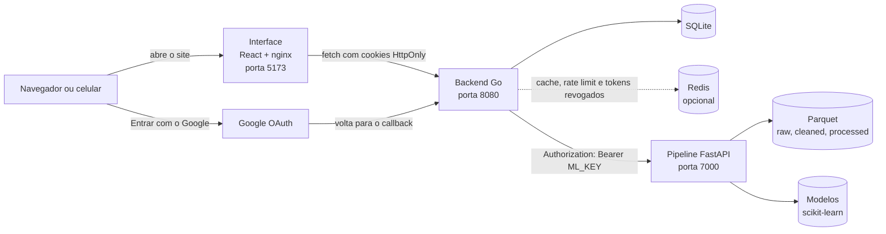
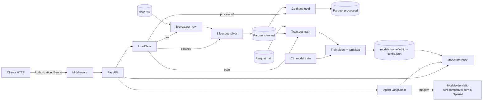
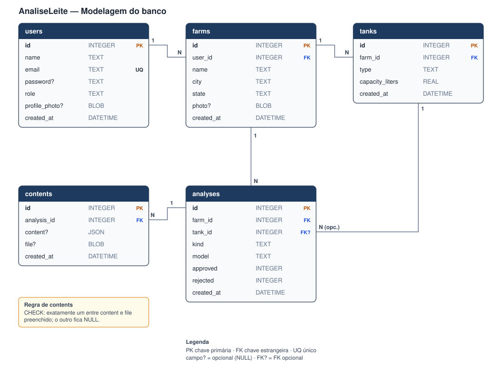

<div align="center">
  <h1>🥛 Análise Leite</h1>
  <h3>Milk Traceability &amp; Data Intelligence</h3>
  <p>
    <em>From farm collection to smarter, safer dairy decisions.</em>
  </p>

  <p>
    <a href="https://github.com/BrayanDevZN/AnaliseLeite/actions/workflows/backend.yaml"></a>
    <a href="https://github.com/BrayanDevZN/AnaliseLeite/actions/workflows/pipeline.yaml"></a>
  </p>

  <p>
    
    
    
    
    
    
  </p>

  <p>
    
    
    
    
    
    
    
    
  </p>
</div>

<p align="center">
  
</p>

## Sobre o projeto

O **Análise Leite** é um sistema para acompanhar a qualidade do leite de uma cooperativa leiteira, da fazenda ao silo. Ele tem três partes que rodam juntas:

- uma **interface web**, pensada primeiro para o celular, onde a pessoa entra, cadastra fazendas e tanques e envia amostras ou arquivos para o modelo analisar;
- um **backend em Go**, que cuida do login, dos usuários, das fazendas, dos tanques e das análises, e guarda o resultado de cada análise;
- um **pipeline em Python**, que trata os dados da cadeia de coleta, calcula indicadores de qualidade e roda modelos de machine learning que estimam se o exame de uma coleta será aprovado ou reprovado.

O cenário parte de um problema real do setor: quando leite com resíduos ou fora dos padrões entra em um tanque comunitário, segue em um caminhão e chega a um silo, vários lotes podem ser afetados. Sem dados relacionados, é difícil reconstruir a origem do problema e distribuir responsabilidades de forma justa.

O sistema ajuda a responder perguntas como:

- quais fazendas e silos apresentam os melhores indicadores de qualidade;
- qual é a média de aprovação dos exames;
- quais volumes, temperaturas, níveis de CCS e CPP foram registrados;
- quais tanques, motoristas e caminhões participaram da coleta;
- como os dados de cadastro das fazendas se relacionam aos eventos de coleta;
- quais características de uma coleta (temperatura, CCS, CPP, tanque, localização) estão associadas à reprovação do exame.

> Os dados presentes no repositório são fictícios e foram preparados para fins acadêmicos. Os arquivos de treino e de teste do modelo são **sintéticos**, gerados com regras de negócio plausíveis (clima por região, sazonalidade, qualidade por fazenda). As métricas do modelo valem para esses dados e não devem ser lidas como desempenho em dados reais.

## Visão geral

| Componente | Tecnologia | Responsabilidade |
|---|---|---|
| **Interface web** | React 19, TypeScript, Vite, Tailwind CSS 4, shadcn/ui | Telas de entrar, cadastro, início (dashboard), fazendas, análises, perfil e usuários. Funciona bem no celular |
| **Backend** | Go 1.26 (biblioteca padrão, `net/http`) | API REST com login, usuários, fazendas, tanques, análises, fotos e estatísticas. É o único cliente do pipeline |
| **Banco de dados** | SQLite (driver `modernc.org/sqlite`, sem CGO) | Guarda usuários, fazendas, tanques, análises e conteúdos. Cria e atualiza as tabelas sozinho ao iniciar |
| **Cache e limite de requisições** | Redis (opcional) | Cache *aside* de 60 s, contagem do *rate limit* e tokens revogados. Sem ele, tudo continua funcionando |
| **Pipeline** | FastAPI, Pandas, PyArrow | Expõe o ETL em `GET /pipeline/` e o modelo em `GET /model/`, `POST /model/`, `POST /model/file` e `POST /model/image`, protegido por chave |
| **Agente de imagem** | LangChain (`langchain-openai`) e qualquer modelo de visão com API compatível com a OpenAI (Groq, LM Studio...) | Lê uma imagem (laudo, tabela, anotação), extrai CCS, CPP, temperatura, data, estado e cidade e devolve a previsão ou uma análise em texto, em `POST /model/image` |
| **Machine learning** | scikit-learn, joblib | Treina modelos (`RandomForestClassifier`) a partir de *templates* e persiste cada um em uma pasta própria, com `config.json` |
| **CLI `model`** | Python | Treina, lista e apaga modelos (`model train`, `model list`, `model drop`) |
| **Docker Compose** | Docker | Sobe a `interface`, o `backend` e o `pipeline` em containers |
| **GitHub Actions** | Workflows `backend` e `pipeline` | Rodam as verificações e os testes dos dois lados |

Nos dados do pipeline, a base contém:

- **40 fazendas** cadastradas e **1.092 coletas** na camada bruta;
- **120 registros agregados** por fazenda e silo na camada processada;
- **322.000 linhas sintéticas de treino** (4 arquivos, 10 estados, 400 fazendas, 12 meses) e **20.000 linhas de teste**.

## Arquitetura do sistema



- A **interface** só fala com o **backend**. Ela nunca chama o pipeline.
- O **backend** é o único cliente do **pipeline**, e manda a `ML_KEY` em cada chamada. Se o pipeline não estiver configurado ou estiver fora do ar, só as rotas do modelo ficam indisponíveis.
- O **Redis** é opcional. Sem a variável `REDIS_URL`, o backend não usa cache e conta o limite de requisições na memória.
- O **banco** é um arquivo SQLite (`base/data/data.db`, ou o caminho de `DATABASE_URL`). No Docker ele fica no volume `backend_data`.

## Funcionalidades

**Para quem usa a interface**

- **Entrar** com email e senha ou com o **Google**. Para criar uma conta é preciso um email `@gmail.com` e uma senha com no mínimo 8 caracteres, uma letra maiúscula, uma minúscula e um número. Logo depois do cadastro dá para adicionar uma **foto de perfil** (ou pular).
- **Início**: saudação pelo horário com a foto de perfil, números do dashboard (fazendas, tanques, análises e % de aprovação), a barra de amostras aprovadas e reprovadas, o gráfico dos últimos 7 dias e as análises recentes.
- **Fazendas**: cadastro com **foto**, edição e exclusão, e os **tanques** de cada fazenda.
- **Análises**: lista de todas as análises que a pessoa fez, com o resultado de cada uma. Uma **nova análise** escolhe a fazenda, o tanque (opcional) e o modelo, e recebe uma amostra (temperatura, CCS, CPP, data, tanque, cidade e estado) ou um arquivo `.csv`/`.parquet`. O resultado fica guardado.
- **Perfil**: foto, nome, email e troca de senha.
- **Usuários** (só admin): criar, editar e apagar usuários e escolher o papel.
- Tema claro e escuro, menu de abas embaixo no celular e menu lateral no computador.

**Para quem opera o sistema**

- Senhas com **bcrypt**, sessão em **cookies HttpOnly** e *rate limit* por usuário, por IP e global.
- Primeiro admin criado a partir de variáveis de ambiente, sem precisar mexer no banco.
- Tudo configurável por variáveis de ambiente ou por um arquivo `base/.env`.

## Arquitetura do pipeline

O ETL segue a arquitetura em camadas (medalhão): **bronze** (`raw`), **silver** (`cleaned`) e **gold** (`processed`), mais a camada **train**, que reúne os dados de treino do modelo. Cada classe herda da anterior, e `LoadData` escolhe qual camada entregar.

O código da API, do ETL e do machine learning fica no serviço **`pipeline`** (`base/src/pipeline/`). O backend em Go (`base/src/backend/`) é o cliente dele: a interface nunca o chama diretamente.



### Fluxo de uma requisição

1. O cliente envia a requisição com o header `Authorization: Bearer <ML_KEY>`. Sem o header, a resposta é `401`; com um header mal formado, `403`; com a chave errada, `401`.
2. Para `GET /pipeline/`, o cliente pode passar `?layer=raw|processed` (padrão: `processed`). A camada `cleaned` ainda não é serializável em JSON; veja a observação em [Uso da API](#get-pipeline).
3. `LoadData(layer)` executa o método da camada pedida.
4. Cada camada reaproveita o arquivo já salvo quando ele existe e, se não existir, gera a partir da camada anterior.
5. O resultado é convertido em JSON: uma lista de registros, ou um objeto com as tabelas `fazendas` e `coletas` na camada `raw`.
6. A API responde com HTTP `201`.

### Fluxo de uma previsão

1. O cliente envia uma coleta em JSON (`POST /model/`) ou um arquivo `.parquet`/`.csv` com várias coletas (`POST /model/file`). Opcionalmente, escolhe o modelo com `?model=<nome>`. Sem esse parâmetro, é usado o modelo mais recente.
2. `ModelInference` carrega a pasta do modelo em `base/src/pipeline/ml/models/<nome>/` e lê o `config.json`.
3. As **colunas de entrada são opcionais**: o `config.json` diz quais colunas aquele modelo usa. Colunas que o modelo não usa são ignoradas. Quando falta uma coluna que o modelo usa (ou o valor está vazio), ela é **preenchida com um valor padrão** e o log avisa o que foi preenchido: a mediana do treino para `temperatura` (3,5), `ccs` (440) e `cpp` (46), a data de hoje para `data` e nenhum estado para `estado`.
4. As colunas derivadas são criadas só a partir das colunas que ficaram: `data` vira ano, mês e dia da semana, e `estado` vira colunas 0/1 (a sigla é normalizada: maiúsculas e sem acento). As colunas que o modelo conhece e não aparecem na entrada recebem `0`.
5. O modelo calcula a probabilidade de reprovação. Se o `config.json` define um `threshold`, a resposta é `reprovado` quando a probabilidade for maior ou igual a ele; sem `threshold`, vale o corte padrão do modelo.
6. A resposta é `aprovado` ou `reprovado` (uma coleta), ou o arquivo original com a coluna `predict` (várias coletas).

> `ccs` e `cpp` do modelo estão em **milhares**: `480` significa 480.000 células/mL. O agente de imagem faz essa conversão sozinho; quem chama `POST /model/` ou `POST /model/file` deve mandar os valores já em milhares.

### Fluxo de uma análise por imagem

1. O cliente envia a imagem em `POST /model/image` (formulário `multipart`, campo `image`). Opcionalmente, escolhe o modelo de previsão com `?model=<nome>`.
2. O `Agent` (`base/src/pipeline/agent/`) manda a imagem em base64, com o prompt `prompts/image.md`, ao modelo de visão e exige uma resposta estruturada: `valid`, `type` (`analytic` ou `text`) e `content`.
3. O resultado cai em um de três caminhos:
   - **Imagem sem relação com leite** (`valid` falso): a API responde `409` com `Invalid image`.
   - **Há números** (`analytic`): `content` é uma **lista com uma entrada por amostra**, com `ccs`, `cpp`, `temperature`, `date`, `state` e `city`; o que não aparece na imagem fica `null`. Entradas sem nenhum número (`ccs`, `cpp` e `temperature` vazios) são descartadas. Depois, `ccs` e `cpp` vão para a escala do modelo: valor com 4 dígitos ou mais é número cheio e é dividido por 1000; com 1 a 3 dígitos já está em milhares e é mantido. Os campos vazios recebem o valor padrão da previsão. Uma amostra devolve `"aprovado"` ou `"reprovado"`; várias devolvem a tabela com a coluna `predict`.
   - **Não há número nenhum, mas a imagem é sobre leite**: uma segunda chamada, com `prompts/text.md`, gera uma análise em texto (o que a imagem mostra, o que dá pra concluir e o que falta).
4. Se a chamada ao modelo de visão falhar, o agente tenta de novo até 3 vezes, com 40 s de espera entre as tentativas.

Os prompts ficam em `base/src/pipeline/agent/prompts/*.md` e são lidos pelo nome do arquivo.

## Pipeline ETL

Os módulos ficam em `base/src/pipeline/etl/`.

### 1. Bronze — camada `raw`

O módulo `bronze.py` (`Bronze.get_raw`) lê `fazendas.csv` e `coletas.csv`, ambos separados por `;`, e devolve as duas tabelas **sem alterações**, em um dicionário `{"fazendas": df, "coletas": df}`.

### 2. Silver — camada `cleaned`

O módulo `silver.py` (`Silver.get_silver`):

- relaciona as tabelas por `fazenda_id` usando um *inner join*;
- converte `data` para data/hora;
- troca vírgula por ponto nos campos decimais;
- converte preço, temperatura, CCS e CPP para tipos numéricos;
- persiste o resultado em Parquet.

### 3. Gold — camada `processed`

O módulo `gold.py` (`Gold.get_gold`):

- converte `resultado_exame` em `1` para aprovado e `0` para não aprovado;
- agrupa os dados por fazenda e silo;
- calcula médias de volume, temperatura, CCS, CPP e aprovação;
- aplica soma ao campo `preco_litro` dentro de cada agrupamento;
- preserva dados descritivos, como fazenda, produtor, tanque, motorista e caminhão;
- renomeia o indicador calculado para `media_aprovacao`;
- ordena os registros por CCS, CPP e média de aprovação;
- grava o resultado final em Parquet.

### 4. Train — camada `train`

O módulo `train.py` (`Train.get_train`) monta o conjunto de treino:

- parte da camada `cleaned`;
- lê todos os arquivos Parquet de `storage/train/`, renomeia-os em sequência (`train_v0.parquet`, `train_v1.parquet`, ...) pela ordem de criação e os concatena ao conjunto.

Todo arquivo colocado em `storage/train/` passa a fazer parte do treino de qualquer modelo novo. Os arquivos precisam ter as mesmas colunas e tipos da camada `cleaned`.

### 5. Interface — `LoadData`

O módulo `interface.py` mapeia `raw`, `cleaned`, `processed` e `train` para `get_raw`, `get_silver`, `get_gold` e `get_train`. O formato devolvido depende **apenas da camada pedida**, e não do que já existe em disco. A leitura e a escrita dos arquivos ficam em `file.py` (`DfFile`).

## Machine learning

O treino fica em `base/src/pipeline/ml/train/`. Ele é organizado em **templates**: cada template define como um tipo de modelo é treinado, e o `TrainModel` (`templates/template.py`) escolhe o template pelo nome e o executa. O `BaseTemplate` (`templates/base.py`) grava o modelo e o `config.json`.

| Item | Detalhe |
|---|---|
| **Algoritmo** | `RandomForestClassifier` (scikit-learn) |
| **Fonte dos dados** | Camada `train` (`cleaned` mais os arquivos de `storage/train/`) |
| **Alvo** | `resultado_exame`: `1` = reprovado, `0` = aprovado |
| **Features** | `temperatura`, `ccs`, `cpp`, ano, mês e dia da semana (derivados de `data`) e `estado`, `cidade` e `tanque` (codificados em colunas 0/1) |
| **Parâmetros** | 180 árvores, `max_depth=8`, `min_samples_leaf=9`, `max_features=0.6`, `criterion="gini"`, `random_state=42` |

### Templates

| Template | O que muda | Quando usar |
|---|---|---|
| `balance` | Usa `class_weight="balanced"`, que dá mais peso à classe `reprovado` | Prioriza encontrar os reprovados (alto *recall*), aceitando muitos alarmes falsos |
| `threshold` | Treina **sem** `class_weight` e grava um `threshold` de `0.05` no `config.json`; a previsão marca `reprovado` quando a probabilidade chega a esse valor | Equilibra melhor acertos e alarmes falsos |

Sem `--template`, o CLI usa o último template registrado (`threshold`). Para criar um template novo, adicione um arquivo em `templates/` e registre-o no dicionário de `template.py`.

### Formato dos modelos salvos

Cada modelo é uma pasta em `base/src/pipeline/ml/models/<nome>/`:

```text
models/anl_threshold_v2/
├── joblib        # o modelo treinado
└── config.json   # configuração usada na previsão
```

```json
{
    "name": "anl_threshold_v2",
    "created_at": "2026-11-24 15:30:00+00:00",
    "features": ["temperatura", "ccs", "cpp", "estado_MG", "cidade_Betim", "..."],
    "threshold": 0.05
}
```

- `features`: as colunas que o modelo usa. A API deriva delas quais colunas de entrada são necessárias.
- `threshold`: o corte de decisão. `null` significa que o modelo usa o corte padrão (50%).

O repositório traz os modelos `anl_v1`, `anl_v2`, `anl_v3`, `anl_threshold` e `anl_threshold_v2`. Sem `?model=`, a API usa o mais recente.

### CLI `model`

O comando `model` é instalado com o pacote (`pip install -e base`):

```bash
model train --name anl_v4 --template threshold   # treina e salva em models/anl_v4/
model train --name anl_v4                        # usa o template padrão
model train                                      # nome automático: anl_v<número>
model list model                                 # lista os modelos disponíveis
model list templates                             # lista os templates disponíveis
model drop anl_v4                                # apaga um modelo
```

`--name` e `--template` são opcionais; `list` e `drop` exigem seus argumentos.

### Resultados

Avaliação no arquivo de teste (`storage/test/analise_leite_teste.parquet`, 20.000 linhas, 311 reprovados, ou 1,6%), em dados sintéticos:

| Modelo | Acerto | Recall | Precision | F1 |
|---|---:|---:|---:|---:|
| `anl_threshold` | 94,5% | 30,9% | 9,8% | 14,9% |
| `anl_threshold_v2` | 94,3% | 30,9% | 9,3% | 14,3% |
| `anl_v3` | 77,4% | 63,3% | 4,3% | 8,0% |
| `anl_v1` | 77,6% | 22,8% | 1,7% | 3,1% |
| `anl_v2` | 64,5% | 30,2% | 1,4% | 2,6% |

Como ler os números:

- **Acerto** sozinho engana: como só 1,6% dos exames reprovam, um modelo que respondesse sempre `aprovado` acertaria 98,4%.
- **Recall:** dos exames que realmente reprovaram, quantos o modelo encontrou.
- **Precision:** dos exames que o modelo marcou como reprovados, quantos realmente reprovaram.
- O `anl_v3` (template `balance`) encontra mais reprovados, ao custo de muitos alarmes falsos. Os modelos `threshold` erram menos alarmes e encontram cerca de 3 em cada 10 reprovados.
- `anl_v1` e `anl_v2` foram treinados com a primeira versão dos dados, em que o resultado do exame era sorteado sem relação com as medições, e por isso não aprenderam um padrão útil.
- O `anl_threshold_v2` foi treinado com os 322.000 registros e cobre `ES`, `MS` e todos os meses do ano. O arquivo de teste atual não tem esses casos, então ele aparece igual ao `anl_threshold`.

## Camadas de dados

```text
base/src/pipeline/storage/
├── raw/        # arquivos CSV recebidos
├── cleaned/    # dados relacionados, tipados e salvos em Parquet
├── processed/  # indicadores agregados, prontos para consumo
├── train/      # arquivos de treino do modelo (Parquet, mesmo formato da cleaned)
└── test/       # arquivo de teste do modelo
```

| Camada | Arquivo | Conteúdo |
|---|---|---|
| `raw` | `fazendas.csv` | Cadastro de fazendas, produtores, localização e preço por litro |
| `raw` | `coletas.csv` | Eventos de coleta, qualidade, logística, silo e resultado de exame |
| `cleaned` | `analise_leite.parquet` | Junção das fontes com tipos normalizados (uma linha por coleta) |
| `processed` | `analise_leite.parquet` | Agregação analítica por fazenda e silo |
| `train` | `train_v0` a `train_v3.parquet` | 322.000 coletas sintéticas: 10.000, 12.000, 100.000 e 200.000 linhas |
| `test` | `analise_leite_teste.parquet` | 20.000 coletas sintéticas, no mesmo formato da `cleaned`, para testar o modelo |

Os principais indicadores de qualidade são:

- **CCS:** contagem de células somáticas; quanto menor, melhor;
- **CPP:** contagem padrão em placas, associada à carga bacteriana; quanto menor, melhor;
- **temperatura:** temperatura do leite no momento do registro;
- **média de aprovação:** proporção dos exames aprovados no agrupamento, de `0` a `1`.

## Estrutura do repositório

```text
AnaliseLeite/
├── base/
│   ├── assets/                       # imagens usadas na documentação
│   ├── docs/                         # modelagem-banco.svg (diagrama do banco)
│   ├── main.go                       # entrada do backend em Go
│   ├── go.mod / go.sum               # dependências do backend
│   ├── src/
│   │   ├── backend/                  # backend em Go
│   │   │   ├── auth/                 # bcrypt e tokens JWT
│   │   │   ├── database/             # acesso aos dados com cache
│   │   │   │   ├── redis/            # conexão e operações do Redis
│   │   │   │   └── repository/       # SQLite: conexão, migração e operations/ (users, farms, tanks, analyses, contents)
│   │   │   ├── handles/              # rotas: auth, google, users, farms, tanks, analyses, dashboard, photos, model
│   │   │   ├── midlleware/           # CORS e rate limit (Redis ou memória)
│   │   │   ├── schema/               # contratos de entrada e saída e a lista de rotas
│   │   │   ├── config.go / dotenv.go # leitura das variáveis de ambiente e do .env
│   │   │   ├── requests.go           # cliente do pipeline
│   │   │   └── logs.go
│   │   ├── frontend/                 # interface web (React + Vite)
│   │   │   ├── pages/                # home, farms, farm-detail, analyses, new-analysis, analysis-detail, profile, users, login, register, photo
│   │   │   ├── components/           # componentes do app e components/ui (shadcn)
│   │   │   ├── lib/                  # api, auth, queries, validação, imagens, formatação
│   │   │   └── App.tsx / main.tsx / index.css
│   │   └── pipeline/                 # serviço Python (ETL, ML e API)
│   │       ├── agent/                # agente de imagem (LangChain): response.py, schema.py e prompts/*.md
│   │       ├── application/          # aplicação FastAPI (handles, midlleware, schema, main)
│   │       ├── etl/                  # camadas bronze, silver, gold, train e interface de carga
│   │       ├── config.py / log.py    # variáveis de ambiente do pipeline e configuração centralizada de logs
│   │       ├── ml/
│   │       │   ├── train/            # CLI model e templates de treino
│   │       │   ├── models/           # um diretório por modelo (joblib + config.json)
│   │       │   └── inference.py      # carga do modelo e previsão
│   │       └── storage/              # camadas raw, cleaned, processed, train e test
│   ├── tests/
│   │   ├── unit/                     # backend (config, hash, jwt, repositório, redis) e pipeline (camada raw)
│   │   ├── integration/              # backend (banco, cache e pipeline) e ETL (silver, train, gold)
│   │   └── functional/               # backend_test.go (API do backend), api.py e model.py (pipeline); agent.py e image.py são manuais (fora do CI)
│   ├── .env / .env.example           # variáveis de ambiente (o .env não é versionado)
│   ├── Dockerfile.back               # imagem do backend
│   ├── Dockerfile.interface          # imagem da interface (build do Vite servido pelo nginx)
│   ├── Dockerfile.pipe               # imagem do pipeline
│   ├── compose.yml                   # sobe interface, backend e pipeline
│   ├── pyproject.toml                # pacote Python e comando model
│   └── requirements.txt              # dependências do pipeline
├── diagramas/                        # diagramas do relatório
├── misc/                             # banner, levantamento de requisitos e leiame
├── .github/workflows/                # workflows backend e pipeline (integração contínua)
├── mascote.png
├── rastreamento.md
└── relatorio.md / .pbix / .pdf
```

## Modelagem do banco

O backend guarda tudo em SQLite. As tabelas são criadas e atualizadas sozinhas quando o backend inicia, então um banco de uma versão anterior ganha as colunas novas sem perder dados.

<p align="center">
  
</p>

| Tabela | O que guarda |
|---|---|
| `users` | Nome, email único, senha com hash (opcional, para quem entra só pelo Google), papel e foto de perfil |
| `farms` | Fazendas de um usuário: nome, cidade, estado e foto |
| `tanks` | Tanques de uma fazenda: tipo e capacidade em litros |
| `analyses` | Uma análise por fazenda, com o tipo (`sample` ou `file`), o modelo usado e quantas amostras foram aprovadas e reprovadas |
| `contents` | O que foi enviado na análise: o JSON da amostra **ou** o arquivo (exatamente um dos dois) |

## Como executar

Todos os comandos são executados na **raiz do repositório** (`AnaliseLeite/`), salvo indicação contrária.

### Variáveis de ambiente

Copie `base/.env.example` para `base/.env` (o `.env` não é versionado) e preencha pelo menos as duas obrigatórias:

```bash
cp base/.env.example base/.env
```

| Variável | Para que serve |
|---|---|
| `JWT_SECRET` | Chave que assina os tokens do backend (mínimo de 32 caracteres) |
| `ML_KEY` | Chave de API do pipeline; o backend a envia em cada chamada |
| `BASE_URL`, `API_KEY`, `MODEL` | Modelo de visão do agente de imagem (`POST /model/image`): endereço da API compatível com a OpenAI, chave e nome do modelo |

Dá para gerar uma chave boa com `openssl rand -hex 32`. As demais variáveis (porta, Redis, CORS, admin inicial, Google) estão na seção [Configuração](#configuração).

### Opção recomendada: Docker Compose

Pré-requisitos: [Docker](https://docs.docker.com/get-docker/) e Docker Compose v2.

```bash
git clone https://github.com/BrayanDevZN/AnaliseLeite.git
cd AnaliseLeite
cp base/.env.example base/.env      # e preencha JWT_SECRET e ML_KEY
docker compose -f base/compose.yml up --build
```

| Serviço | Endereço | O que é |
|---|---|---|
| `interface` | <http://localhost:5173> | O site |
| `backend` | <http://localhost:8080> | API do backend (`/health` para conferir) |
| `pipeline` | <http://localhost:7000> | API do ETL e do modelo (exige `Authorization: Bearer <ML_KEY>`, inclusive em `/health` e `/docs`) |

Dentro do Compose o backend já encontra o pipeline em `http://pipeline:7000` e grava o banco no volume `backend_data`, então os dados sobrevivem a reinícios.

Para criar o primeiro administrador sem mexer no banco, defina `ADMIN_EMAIL` e `ADMIN_PASSWORD` no `.env` antes de subir. Depois de mudar o código, reconstrua só o que mudou, por exemplo `docker compose -f base/compose.yml up -d --build backend interface`.

Para encerrar:

```bash
docker compose -f base/compose.yml down
```

> A interface grava o endereço do backend (`VITE_API_URL`) no JavaScript na hora do *build*. Se mudar esse valor, refaça a imagem da interface. A porta do site (`INTERFACE_PORT`) precisa estar na lista `CORS_ORIGINS`.

### Execução local (sem Docker)

Use três terminais. Pré-requisitos: Go 1.26, Node 24 com [pnpm](https://pnpm.io/) e Python 3.14.

**1. Pipeline** (na raiz do repositório):

```bash
python -m venv .venv
source .venv/bin/activate
python -m pip install --upgrade pip
pip install -r base/requirements.txt
pip install -e base          # instala o comando model
ML_KEY=<a mesma do .env> python -m uvicorn base.src.pipeline.application.main:app --host 0.0.0.0 --port 7000 --reload
```

**2. Backend** (em `base/`, onde está o `.env`):

```bash
cd base
go run .
```

Sem `DATABASE_URL`, o banco é criado em `base/data/data.db`. Sem `REDIS_URL`, não há cache. Para ter Redis, suba um com `docker run -p 6379:6379 redis:7` e defina `REDIS_URL=redis://localhost:6379/0`.

**3. Interface** (em `base/src/frontend/`):

```bash
cd base/src/frontend
pnpm install
pnpm dev                     # http://localhost:5173
```

A interface procura o backend em `http://localhost:8080`; para outro endereço, defina `VITE_API_URL`. Outros comandos: `pnpm lint`, `pnpm typecheck` e `pnpm build`.

### Login com o Google (opcional)

Sem as variáveis do Google, o botão continua na tela, mas as rotas `/auth/google` respondem `503`. Para ligar:

1. Crie um *OAuth client ID* do tipo **Web** em [console.cloud.google.com](https://console.cloud.google.com).
2. Cadastre lá o endereço de retorno `http://localhost:8080/auth/google/callback` (o mesmo valor de `GOOGLE_REDIRECT_URL`).
3. Preencha `GOOGLE_CLIENT_ID` e `GOOGLE_CLIENT_SECRET` no `.env`.
4. Defina `GOOGLE_SUCCESS_URL` e `GOOGLE_FAILURE_URL` com os endereços do site para onde a pessoa volta (por exemplo `http://localhost:5173/` e `http://localhost:5173/entrar`).

Quem já tem conta com senha e entra com o Google usando o mesmo email cai na mesma conta. Contas novas só podem ser criadas com email `@gmail.com`.

## Uso da API do backend

A interface usa esta API, e você também pode chamá-la direto. A sessão fica em **cookies HttpOnly** (token de acesso de 15 minutos e token de renovação de 7 dias, com rotação). Ao trocar de token, o antigo é revogado.

```bash
# criar conta e entrar (o -c guarda os cookies e o -b os envia)
curl -c jar -X POST http://localhost:8080/auth/register -H "Content-Type: application/json" \
  -d '{"name":"Maria","email":"maria@gmail.com","password":"Senha-forte-1"}'
curl -c jar -X POST http://localhost:8080/auth/login -H "Content-Type: application/json" \
  -d '{"email":"maria@gmail.com","password":"Senha-forte-1"}'

# criar uma fazenda e analisar uma amostra
curl -b jar -X POST http://localhost:8080/farms -H "Content-Type: application/json" \
  -d '{"name":"Fazenda Sol","city":"Uberaba","state":"MG"}'
curl -b jar -X POST http://localhost:8080/farms/1/analyses -H "Content-Type: application/json" \
  -d '{"sample":{"temperature":4.2,"ccs":480,"cpp":250,"state":"MG","cidade":"Uberaba","tanque":"TC01","data":"2026-03-02"}}'

# painel e lista de análises
curl -b jar http://localhost:8080/stats
curl -b jar "http://localhost:8080/analyses?limit=20&offset=0"
```

Regras de validação: o email precisa ser `@gmail.com` e a senha precisa ter 8 ou mais caracteres, uma letra maiúscula, uma minúscula e um número. Dados inválidos respondem `422` com a lista de motivos por campo.

| Método | Rota | Acesso | O que faz |
|---|---|---|---|
| `GET` | `/health` | público | Confere se o backend está de pé |
| `POST` | `/auth/register` | público | Cria uma conta |
| `POST` | `/auth/login` | público | Entra com email e senha (tokens nos cookies) |
| `POST` | `/auth/refresh` | público | Troca o token de renovação por tokens novos |
| `POST` | `/auth/logout` | público | Sai: invalida o token de renovação e limpa os cookies |
| `GET` | `/auth/google` | público | Começa o login com o Google |
| `GET` | `/auth/google/callback` | público | Volta do Google, entra e redireciona para o site |
| `GET`, `PATCH` | `/me` | logado | Dados do próprio usuário; edita nome, email e senha |
| `PUT`, `DELETE` | `/me/photo` | logado | Troca ou remove a própria foto de perfil |
| `GET` | `/users/{id}/photo` | logado | Foto de perfil (só o próprio usuário ou um admin) |
| `POST`, `GET` | `/users` | admin | Cria e lista usuários |
| `GET`, `PATCH`, `DELETE` | `/users/{id}` | admin | Busca, atualiza e apaga um usuário |
| `POST`, `GET` | `/farms` | logado | Cria e lista as fazendas do usuário |
| `GET`, `PATCH`, `DELETE` | `/farms/{id}` | logado | Busca, atualiza e apaga uma fazenda |
| `GET`, `PUT`, `DELETE` | `/farms/{id}/photo` | logado | Foto da fazenda |
| `POST`, `GET` | `/farms/{id}/tanks` | logado | Cria e lista os tanques da fazenda |
| `GET`, `PATCH`, `DELETE` | `/tanks/{id}` | logado | Busca, atualiza e apaga um tanque |
| `POST`, `GET` | `/farms/{id}/analyses` | logado | Cria uma análise (roda o modelo) e lista as da fazenda |
| `GET` | `/analyses` | logado | Lista as análises de todas as fazendas do usuário (`?limit=&offset=`) |
| `GET` | `/stats` | logado | Resumo para o painel de início (`?offset=` é o fuso em minutos a leste de UTC) |
| `GET`, `DELETE` | `/analyses/{id}` | logado | Busca e apaga uma análise |
| `GET` | `/analyses/{id}/contents` | logado | Lista o que foi enviado na análise |
| `GET` | `/analyses/{id}/rows` | logado | Roda o modelo de novo no arquivo guardado e devolve uma linha por amostra (só análises de arquivo) |
| `GET` | `/models` | logado | Lista os modelos do pipeline |

Cada usuário só enxerga as próprias fazendas, tanques, análises e fotos; um admin também vê as fotos de perfil. As fotos aceitam JPEG, PNG, GIF e WebP (o tipo é conferido pelos bytes, não pelo nome do arquivo) e são servidas com cabeçalhos que impedem que sejam executadas como página.

## Uso da API do pipeline

Os exemplos abaixo chamam o pipeline direto (em geral só o backend faz isso) e usam a variável `KEY` com a mesma chave do `ML_KEY`:

```bash
KEY="uma-chave-secreta"        # o mesmo valor de ML_KEY
URL="http://localhost:8000"
```

### Passo a passo: da chave até uma previsão

1. **Suba o serviço** (veja [Como executar](#como-executar)) com a `ML_KEY` definida.
2. **Confira que ele responde:**
   ```bash
   curl -H "Authorization: Bearer $KEY" $URL/health
   # {"status":true}
   ```
3. **Veja quais modelos existem:**
   ```bash
   curl -H "Authorization: Bearer $KEY" $URL/model/
   # ["anl_v1","anl_v2","anl_threshold_v2","anl_threshold","anl_v3"]
   ```
4. **Preveja uma coleta**, escolhendo um dos modelos da lista:
   ```bash
   curl -X POST "$URL/model/?model=anl_threshold_v2" \
     -H "Authorization: Bearer $KEY" -H "Content-Type: application/json" \
     -d '{"temperature": 4.2, "state": "MG", "data": "2026-03-02", "ccs": 480, "cpp": 250, "cidade": "Betim", "tanque": "TC01"}'
   # "aprovado"
   ```
5. **Ou preveja um arquivo inteiro:**
   ```bash
   curl -X POST "$URL/model/file?model=anl_threshold_v2" \
     -H "Authorization: Bearer $KEY" \
     -F "file=@base/src/pipeline/storage/test/analise_leite_teste.parquet"
   ```

### Autenticação

Toda requisição deve enviar o header `Authorization: Bearer <chave>`, inclusive `/health` e `/docs`.

| Situação | Resposta |
|---|---|
| Header ausente | `401` — `{"detail":"Expeted Authorization header"}` |
| Header sem o formato `Bearer <chave>` | `403` — `{"detail":"Invalid Authorization header"}` |
| Chave incorreta | `401` — `{"detail":"Invalid credential"}` |

### `GET /health`

Verifica se o serviço está de pé. Não recebe parâmetros.

```bash
curl -H "Authorization: Bearer $KEY" http://localhost:7000/health
```

### `GET /pipeline/`

Retorna os dados da camada escolhida em JSON, com status `201`.

| Parâmetro (query) | Valores | Padrão |
|---|---|---|
| `layer` | `raw`, `processed` (veja a observação abaixo sobre `cleaned`) | `processed` |

```bash
curl -H "Authorization: Bearer $KEY" http://localhost:7000/pipeline/
curl -H "Authorization: Bearer $KEY" "http://localhost:7000/pipeline/?layer=raw"
```

- Na camada `processed`, a resposta é uma lista de registros agregados por fazenda e silo.
- Na camada `raw`, a resposta é um objeto com as duas tabelas: `{"fazendas": [...], "coletas": [...]}`.

Exemplo resumido de resposta (camada `processed`):

```json
[
  {
    "nome_fazenda": "Sitio Campo Verde II",
    "produtor": "Nelson Aguiar",
    "cidade": "Mateus Leme",
    "estado": "MG",
    "preco_litro": 19.62,
    "tanque": "TI15",
    "tipo_tanque": "individual",
    "volume_litros": 1227.78,
    "temperatura": 4.38,
    "ccs": 306.44,
    "cpp": 221.44,
    "motorista": "Djalma Souto",
    "caminhao": "CAM-102",
    "media_aprovacao": 0.89
  }
]
```

> **Limitação conhecida:** `?layer=cleaned` responde `501` com `Object of type Timestamp is not JSON serializable`, porque a coluna `data` dessa camada é uma data/hora que ainda não é convertida para JSON. Use `processed` ou `raw`.

### `GET /model/`

Lista os nomes dos modelos que existem em `base/src/pipeline/ml/models/`. Use um desses nomes no parâmetro `model` das rotas de previsão.

```bash
curl -H "Authorization: Bearer $KEY" http://localhost:7000/model/
```

### `POST /model/file`

Recebe um arquivo `.parquet` ou `.csv` (separado por `;`) com várias coletas e devolve cada linha com todas as colunas originais mais a coluna `predict` (`aprovado` ou `reprovado`). O arquivo deve ter as colunas que o modelo escolhido usa (os modelos atuais usam `data`, `temperatura`, `ccs`, `cpp` e `estado`), com `ccs` e `cpp` em milhares. Coluna ausente ou valor vazio é preenchido com um valor padrão, e o log avisa. As demais colunas são ignoradas na previsão e mantidas na resposta.

| Parâmetro | Descrição |
|---|---|
| `model` (query) | Nome do modelo. Opcional; padrão: o mais recente |

```bash
curl -X POST "http://localhost:7000/model/file?model=anl_threshold_v2" \
  -H "Authorization: Bearer $KEY" \
  -F "file=@base/src/pipeline/storage/test/analise_leite_teste.parquet"
```

### `POST /model/`

Recebe uma coleta em JSON e devolve `"aprovado"` ou `"reprovado"`. **Todos os campos são opcionais**: o que faltar e o modelo usar é preenchido com um valor padrão (e o log avisa). Campos que o modelo não usa são ignorados. `ccs` e `cpp` vão em milhares.

| Campo | Tipo | Exemplo |
|---|---|---|
| `temperature` | número | `4.2` |
| `state` | sigla do estado (UF) | `"MG"` |
| `data` | texto `AAAA-MM-DD` | `"2026-03-02"` |
| `ccs` | número | `480` |
| `cpp` | número | `250` |

**Todos os campos são opcionais no contrato**, mas cada modelo exige as colunas que usa (listadas no `config.json` dele). Com os modelos do repositório, são exigidos os sete campos. Se faltar um, a resposta é `501` com a mensagem `Expeted columns <coluna>`. Campos que o modelo não usa são ignorados.

```bash
curl -X POST "http://localhost:7000/model/?model=anl_threshold_v2" \
  -H "Authorization: Bearer $KEY" \
  -H "Content-Type: application/json" \
  -d '{"temperature": 4.2, "state": "MG", "data": "2026-03-02", "ccs": 480, "cpp": 250}'
```
```json
"aprovado"
```

### `POST /model/file`

Recebe um arquivo `.parquet` ou `.csv` (separado por `;`) com **várias** coletas e devolve cada linha do arquivo, com **todas as colunas originais**, mais a coluna `predict` (`aprovado` ou `reprovado`).

| Parâmetro | Onde | Descrição |
|---|---|---|
| `file` | formulário (`multipart/form-data`) | O arquivo. O nome do campo deve ser `file` |
| `model` | query | Nome do modelo. Opcional; padrão: o mais recente |

O arquivo precisa ter as colunas que o modelo escolhido usa (para os modelos do repositório: `data`, `temperatura`, `ccs`, `cpp`, `tanque`, `estado` e `cidade`). As demais colunas, como `fazenda_id` e `resultado_exame`, são ignoradas na previsão e mantidas na resposta.

```bash
curl -X POST "$URL/model/file?model=anl_threshold_v2" \
  -H "Authorization: Bearer $KEY" \
  -F "file=@base/src/pipeline/storage/test/analise_leite_teste.parquet"
```

Resposta (cada item é uma linha do arquivo; abaixo, o primeiro item):

```json
[
  {
    "fazenda_id": "F001",
    "nome_fazenda": "Sitio Aurora I",
    "produtor": "Adalberto Ribeiro",
    "cidade": "Betim",
    "estado": "MG",
    "preco_litro": 2.36,
    "data": "2025-09-03T00:00:00",
    "tanque": "TC01",
    "tipo_tanque": "comunitario",
    "volume_litros": 1153,
    "temperatura": 3.9,
    "ccs": 690,
    "cpp": 405,
    "motorista": "Djalma Souto",
    "caminhao": "CAM-102",
    "silo": "SILO-B",
    "resultado_exame": "aprovado",
    "predict": "aprovado"
  }
]
```

Para comparar a previsão com o resultado real, basta comparar as colunas `predict` e `resultado_exame` (se o arquivo tiver a segunda).

### Escolhendo o modelo

| Modelo | Perfil |
|---|---|
| `anl_threshold_v2` | Treinado com todos os arquivos de treino (10 estados, 12 meses). Equilibra acertos e alarmes falsos. É o padrão, por ser o mais recente |
| `anl_threshold` | Mesmo template, treinado com menos dados. Resultado muito parecido |
| `anl_v3` | Template `balance`: encontra mais reprovados, com muitos alarmes falsos |
| `anl_v1`, `anl_v2` | Treinados com a primeira versão dos dados. Mantidos só para comparação |

As métricas de cada um estão na seção [Machine learning](#resultados).

### Usando a API em Python

```python
import pandas as pd
import requests

URL = "http://localhost:8000"
headers = {"Authorization": "Bearer uma-chave-secreta"}

# 1. quais modelos existem?
modelos = requests.get(f"{URL}/model/", headers=headers).json()
print(modelos)

# 2. prever uma coleta
coleta = {"temperature": 4.2, "state": "MG", "data": "2026-03-02",
          "ccs": 480, "cpp": 250, "cidade": "Betim", "tanque": "TC01"}
resposta = requests.post(f"{URL}/model/", params={"model": "anl_threshold_v2"},
                         json=coleta, headers=headers)
print(resposta.status_code, resposta.json())      # 200 "aprovado"

# 3. prever um arquivo e abrir o resultado como DataFrame
with open("coletas.parquet", "rb") as f:
    resposta = requests.post(f"{URL}/model/file", params={"model": "anl_threshold_v2"},
                             files={"file": f}, headers=headers)
df = pd.DataFrame(resposta.json())
print(df["predict"].value_counts())
```

### Erros comuns

| Resposta | Mensagem | Causa e o que fazer |
|---|---|---|
| `401` | `Expeted Authorization header` | Faltou o header `Authorization`. Envie `Authorization: Bearer <chave>` |
| `403` | `Invalid Authorization header` | O header não tem o formato `Bearer <chave>` |
| `401` | `Invalid credential` | A chave não é igual à `ML_KEY` do serviço |
| `422` | detalhes do campo | Um campo do JSON é inválido (por exemplo, uma UF que não existe). A mensagem diz qual campo |
| `501` | `Expeted columns ccs` | O modelo usa essa coluna e ela não veio. Envie a coluna que falta |
| `501` | `No active exception to reraise` | O nome passado em `?model=` não existe. Consulte `GET /model/` e use um dos nomes |
| `501` | `429: Expeted csv or parquet file` | O arquivo enviado não é `.csv` nem `.parquet` |
| `501` | `Object of type Timestamp is not JSON serializable` | Foi pedido `?layer=cleaned`. Use `processed` ou `raw` |

Os erros de previsão saem com status `501` e a mensagem em `detail`. Para ver as rotas e os esquemas de forma interativa, abra o Swagger em `/docs` com um cliente que consiga enviar o header `Authorization`.

### `POST /model/image`

Recebe **uma imagem** (laudo, tabela, anotação, foto) e usa o agente de imagem para extrair os dados e prever. O campo do formulário deve se chamar `image`.

| Parâmetro | Descrição |
|---|---|
| `image` (formulário) | Arquivo de imagem (JPEG). Obrigatório |
| `model` (query) | Nome do modelo de previsão. Opcional; padrão: o mais recente |

```bash
curl -X POST "http://localhost:7000/model/image" \
  -H "Authorization: Bearer $KEY" \
  -F "image=@base/src/pipeline/storage/test/imagem_valida.jpg"
```

A resposta depende do que o agente achou na imagem:

| Situação | Status | Corpo |
|---|:---:|---|
| Uma amostra com números | `200` | `"aprovado"` ou `"reprovado"` |
| Várias amostras com números | `200` | Objeto com uma chave por coluna (`ccs`, `cpp`, `temperatura`, `data`, `estado`, `city`, `predict`), cada uma com os valores indexados por linha (`{"predict": {"0": "aprovado", "1": "reprovado"}}`) |
| Sem número nenhum, mas a imagem é sobre leite | `200` | Texto com a análise do agente |
| Imagem sem relação com leite | `409` | `{"detail": "Invalid image"}` |

Pontos de atenção:

- Cada chamada usa o modelo de visão configurado em `BASE_URL`, `API_KEY` e `MODEL` (veja [Configuração](#configuração)). Com um modelo local ou o limite de uso de um provedor gratuito, a resposta pode levar de dezenas de segundos a minutos, e uma falha temporária repete a chamada até 3 vezes, com 40 s de espera.
- Valores que a imagem não mostra (por exemplo, a temperatura) são preenchidos com o padrão na previsão, então o resultado vale como estimativa. A resposta de várias amostras mantém as colunas com os valores lidos da imagem, e os campos que o modelo preencheu aparecem vazios (`null`).
- Modelos de visão pequenos (3B) leem tabelas com erros ocasionais de dígito e variam de uma execução para outra. Prefira um modelo maior quando possível.

## Testes e integração contínua

### Backend (Go)

Os testes ficam em `base/tests/` e rodam a partir de `base/`:

```bash
cd base
test -z "$(gofmt -l .)" && go vet ./...                 # formatação e análise estática
set -a; . ./.env; set +a                                 # carrega o .env (os testes de integração usam o pipeline)
go test -race -count=1 ./tests/unit/                     # config, hash, JWT, repositório e Redis
go test -race -count=1 ./tests/integration/              # banco, cache e pipeline
```

- Os testes de **repositório** usam SQLite em arquivo temporário. Os de **Redis** e de **cache** usam um Redis de verdade: o apontado por `TEST_REDIS_URL` ou um `redis-server` instalado na máquina (sem nenhum dos dois, os de integração são pulados).
- Os de integração com o pipeline precisam dele no ar (`docker compose -f base/compose.yml up -d pipeline`) e da `ML_KEY`.
- O teste **funcional** (`tests/functional/backend_test.go`) chama a API do backend em execução: cadastro, login, renovação de token, fazendas, tanques, análises com amostra e com arquivo, fotos, painel e as regras de acesso. Ele entra com o admin do `ADMIN_EMAIL` e `ADMIN_PASSWORD` e usa a `PORT` do `.env`:

```bash
cd base
go run . &                                               # backend em outro terminal, se preferir
go test -count=1 -v ./tests/functional/
```

### Interface (React)

```bash
cd base/src/frontend
pnpm lint
pnpm typecheck
pnpm build
```

### Pipeline (Python)

Os testes do pipeline são scripts executáveis como módulos Python, na raiz do repositório. O `functional.api` precisa da `ML_KEY` (no ambiente ou em `base/.env`) para autenticar as chamadas.

```bash
# Unitários
python -m base.tests.unit.raw

# Integração
python -m base.tests.integration.silver
python -m base.tests.integration.train
python -m base.tests.integration.gold

# Funcionais — requerem o pacote requests
pip install requests
python -m base.tests.functional.model   # avalia todos os modelos no arquivo de teste (roda sem a API)
python -m base.tests.functional.api     # chama a API em execução na porta 7000

# Manuais (usam o modelo de visão e não rodam no CI)
python -m base.tests.functional.agent   # as três imagens de storage/test/ direto no agente
python -m base.tests.functional.image   # uma requisição a POST /model/image, com a API em execução
```

- `functional.model` imprime, para cada modelo, o percentual de acerto, o *recall*, a *precision*, o *f1* e a matriz de confusão, além de uma previsão de uma única linha.
- `functional.api` exige a API em execução (Docker Compose). Ele chama `GET /pipeline`, `GET /model/` e, para cada modelo listado, `POST /model/file` e `POST /model/`.
- `functional.agent` roda o agente nas imagens de `storage/test/` (`imagem_valida.jpg`, `imagem_sem_parametros.jpg` e `imagem_invalida.jpg`) e confere o tipo de resposta de cada uma. `functional.image` faz uma única chamada a `POST /model/image`. Os dois dependem do modelo de visão (cota e tempo) e variam de uma execução para outra, por isso ficam fora do CI.
- `integration.train` monta o conjunto de treino e **renomeia os arquivos de `storage/train/`** em `train_v0`, `train_v1`, ...

### GitHub Actions

Há dois workflows, executados em *push* e *pull request*:

| Workflow | O que roda |
|---|---|
| `backend.yaml` | Verifica a formatação (`gofmt`) e a análise estática (`go vet`), roda os testes unitários (com `-race`), sobe o pipeline e um Redis, roda os testes de integração, sobe o backend e roda o teste funcional |
| `pipeline.yaml` | Usa o *environment* `develop_pl` do GitHub, que fornece as secrets `ML_KEY`, `BASE_URL`, `API_KEY` e `MODEL`, sobe a API com Docker Compose, instala as dependências e roda, nesta ordem, o teste unitário, os de integração e os funcionais |

## Configuração

Todas as variáveis podem vir do ambiente ou do arquivo `base/.env`. O modelo completo, comentado, está em `base/.env.example`.

| Variável | Obrigatória | Padrão | Descrição |
|---|:---:|---|---|
| `JWT_SECRET` | sim | | Chave que assina os tokens (mínimo de 32 caracteres) |
| `ML_KEY` | sim | | Chave de API do pipeline. O backend a envia no header `Authorization: Bearer` |
| `BASE_URL` | sim, no pipeline | | Endereço da API compatível com a OpenAI usada pelo agente de imagem, terminando em `/v1`. Ex.: `https://api.groq.com/openai/v1` ou, no LM Studio, `http://127.0.0.1:1234/v1`. Dentro do Docker, `127.0.0.1` é o próprio container |
| `API_KEY` | sim, no pipeline | | Chave (ou token) dessa API. No LM Studio com autenticação ligada, é o token dele |
| `MODEL` | sim, no pipeline | | Nome do modelo de visão, como a API o conhece. Ex.: `qwen/qwen3.8-27b` (Groq) ou `qwen2.5-vl-3b-instruct` (LM Studio) |
| `PORT` | não | `8080` | Porta do backend |
| `MODEL_URL` | não | | Endereço do pipeline. No Compose vira `http://pipeline:7000`. Sem ele, só as rotas do modelo ficam fora do ar |
| `DATABASE_URL` | não | `data/data.db` | Banco SQLite. No Compose vira `sqlite:///data/app.db` |
| `REDIS_URL` | não | | Liga o cache e conta o *rate limit* no Redis. Sem ela, não há cache e o limite conta na memória |
| `CORS_ORIGINS` | não | | Origens do site autorizadas a chamar a API com cookies, separadas por vírgula. Sem ela, o CORS fica desligado |
| `COOKIE_INSECURE` | não | | `true` tira o `Secure` dos cookies: só para desenvolvimento local em http |
| `COOKIE_DOMAIN` | não | | Domínio dos cookies |
| `TRUST_PROXY` | não | `false` | `true` só se o backend estiver atrás de um proxy confiável (usa o IP vindo dele) |
| `ADMIN_EMAIL`, `ADMIN_PASSWORD`, `ADMIN_NAME` | não | | Criam este administrador na primeira vez que o backend sobe |
| `GOOGLE_CLIENT_ID`, `GOOGLE_CLIENT_SECRET`, `GOOGLE_REDIRECT_URL` | não | | Ligam o login com o Google. Sem eles, `/auth/google` responde `503` |
| `GOOGLE_SUCCESS_URL`, `GOOGLE_FAILURE_URL` | não | `/` | Para onde o navegador vai depois de entrar e quando dá erro |
| `VITE_API_URL` | não | `http://localhost:8080` | Endereço do backend como o **navegador** o enxerga (gravado no *build* da interface) |
| `INTERFACE_PORT` | não | `5173` | Porta do site no seu computador |
| `BACKEND_URL` | não | `http://backend:8080` | Só na interface: para onde o nginx repassa `/api/...`. Use com `VITE_API_URL=/api` quando o site e o backend ficam em domínios diferentes |

As três variáveis do agente (`BASE_URL`, `API_KEY`, `MODEL`) precisam estar definidas para o pipeline subir (podem ficar vazias, mas o agente só funciona com valores válidos). O `compose.yml` as repassa ao container do `pipeline`.

| Serviço | Porta |
|---|---:|
| Interface | `5173` |
| Backend (Go) | `8080` |
| Pipeline (FastAPI) | `7000` |
| Redis (se usar) | `6379` |

O arquivo `base/.env` não é versionado (está no `.gitignore`). No CI, as chaves vêm de secrets do GitHub ou são valores de teste definidos no próprio workflow.

## Segurança

- Senhas guardadas com **bcrypt**. Os tokens JWT (HS256) vão em **cookies HttpOnly**, o de acesso dura 15 minutos e o de renovação 7 dias, com rotação e lista de tokens revogados.
- Login com o Google pelo fluxo *Authorization Code* com **PKCE**.
- **CORS** só para as origens listadas em `CORS_ORIGINS`.
- **Rate limit** por usuário, por IP e global, no Redis ou, sem ele, na memória.
- Cada usuário acessa apenas os próprios dados; as rotas de usuários exigem o papel de admin.
- Fotos validadas pelos bytes do arquivo (JPEG, PNG, GIF ou WebP) e servidas com `nosniff` e CSP restritiva. O navegador reduz a imagem antes de enviar.
- O pipeline só aceita chamadas com a `ML_KEY`, e a interface nunca fala com ele diretamente.

## Logs

O pipeline registra eventos no terminal com a biblioteca `watchguardian` (configurada em `base/src/pipeline/logs/log.py`), incluindo leitura de camadas, transformações, carga de modelos, validação da chave e erros. O backend registra no terminal o que acontece na inicialização, os erros e o encerramento (`base/src/backend/logs.go`).

## Próximos passos

- avaliar os modelos em um arquivo de teste que cubra todas as regiões e meses do treino (`ES`, `MS`, março a agosto);
- escolher o `threshold` com um conjunto de validação separado, e não pelo arquivo de teste;
- adicionar um template com `HistGradientBoosting` e outro com regressão logística, para comparar com a floresta aleatória;
- registrar no `config.json` com quais arquivos de treino cada modelo foi treinado;
- testar features de histórico por fazenda (médias e taxa de reprovação das coletas anteriores);
- mostrar na interface os indicadores do pipeline (camadas `processed`), com filtros por fazenda, silo, período, motorista e resultado;
- guardar o resultado linha a linha das análises por arquivo, para poder reabrir e filtrar quais amostras foram reprovadas;
- adicionar testes automatizados da interface (hoje ela é validada por lint, checagem de tipos e testes manuais);
- adotar modelos de resposta do Pydantic e documentação detalhada do contrato do pipeline;
- transformar os scripts de teste do pipeline em uma suíte com `pytest` e métricas de cobertura;
- incluir observabilidade (métricas e *traces*) para um cenário de produção.

## Documentação do domínio

- [Cenário geral e orientações do trabalho](misc/leiame.md)
- [Problema de rastreamento do leite](rastreamento.md)
- [Relatório do projeto](relatorio.md)

---

<p align="center">
  Desenvolvido para transformar a cadeia do leite em uma operação mais rastreável, mensurável e transparente.
</p>
