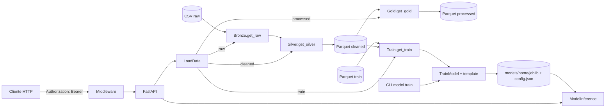

<div align="center">
  <h1>🥛 Análise Leite</h1>
  <h3>Milk Traceability &amp; Data Intelligence</h3>
  <p>
    <em>From farm collection to smarter, safer dairy decisions.</em>
  </p>

  <p>
    <a href="https://github.com/BrayanDevZN/AnaliseLeite/actions/workflows/pipeline.yaml"></a>
  </p>

  <p>
    
    
    
    
    
  </p>
</div>

<p align="center">
  
</p>

## Sobre o projeto

O **Análise Leite** é um projeto de engenharia de dados voltado ao rastreamento da cadeia de coleta de uma cooperativa leiteira. Ele relaciona fazendas e coletas, trata os dados operacionais, calcula indicadores de qualidade, disponibiliza o resultado por uma API REST protegida por chave e inclui modelos de machine learning que estimam se o exame de uma coleta será aprovado ou reprovado.

O cenário parte de um problema real do setor: quando leite com resíduos ou fora dos padrões entra em um tanque comunitário, segue em um caminhão e chega a um silo, vários lotes podem ser afetados. Sem dados relacionados, é difícil reconstruir a origem do problema e distribuir responsabilidades de forma justa.

O pipeline ajuda a responder perguntas como:

- quais fazendas e silos apresentam os melhores indicadores de qualidade;
- qual é a média de aprovação dos exames;
- quais volumes, temperaturas, níveis de CCS e CPP foram registrados;
- quais tanques, motoristas e caminhões participaram da coleta;
- como os dados de cadastro das fazendas se relacionam aos eventos de coleta;
- quais características de uma coleta (temperatura, CCS, CPP, tanque, localização) estão associadas à reprovação do exame.

> Os dados presentes no repositório são fictícios e foram preparados para fins acadêmicos. Os arquivos de treino e de teste do modelo são **sintéticos**, gerados com regras de negócio plausíveis (clima por região, sazonalidade, qualidade por fazenda). As métricas do modelo valem para esses dados e não devem ser lidas como desempenho em dados reais.

## Visão geral

| Componente | Responsabilidade |
|---|---|
| **FastAPI** | Expõe o pipeline em `GET /pipeline/` e o modelo em `GET /model/`, `POST /model/` e `POST /model/file` |
| **Middleware de autenticação** | Exige o header `Authorization: Bearer <ML_KEY>` em todas as rotas |
| **Pandas** | Lê, relaciona, limpa, agrupa e ordena os dados |
| **Parquet / PyArrow** | Armazena as camadas tratada, processada e de treino de forma eficiente |
| **scikit-learn / joblib** | Treina modelos (`RandomForestClassifier`) a partir de *templates* e persiste cada um em uma pasta própria, com `config.json` |
| **CLI `model`** | Treina, lista e apaga modelos (`model train`, `model list`, `model drop`) |
| **Docker Compose** | Sobe o serviço `pipeline` em container |
| **GitHub Actions** | Workflow `pipeline`: sobe a API com Docker Compose e executa os testes |

Atualmente, a base contém:

- **40 fazendas** cadastradas e **1.092 coletas** na camada bruta;
- **120 registros agregados** por fazenda e silo na camada processada;
- **322.000 linhas sintéticas de treino** (4 arquivos, 10 estados, 400 fazendas, 12 meses) e **20.000 linhas de teste**.

## Arquitetura

O ETL segue a arquitetura em camadas (medalhão): **bronze** (`raw`), **silver** (`cleaned`) e **gold** (`processed`), mais a camada **train**, que reúne os dados de treino do modelo. Cada classe herda da anterior, e `LoadData` escolhe qual camada entregar.

O código da API, do ETL e do machine learning fica no serviço **`pipeline`** (`base/src/pipeline/`). A pasta `base/src/backend/` está reservada para um backend em Go, que chamará esse serviço.



### Fluxo de uma requisição

1. O cliente envia a requisição com o header `Authorization: Bearer <ML_KEY>`. Sem o header, a resposta é `401`; com um header mal formado, `403`; com a chave errada, `401`.
2. Para `GET /pipeline/`, o cliente pode passar `?layer=raw|cleaned|processed` (padrão: `processed`).
3. `LoadData(layer)` executa o método da camada pedida.
4. Cada camada reaproveita o arquivo já salvo quando ele existe e, se não existir, gera a partir da camada anterior.
5. O resultado é convertido em JSON: uma lista de registros, ou um objeto com as tabelas `fazendas` e `coletas` na camada `raw`.
6. A API responde com HTTP `201`.

### Fluxo de uma previsão

1. O cliente envia uma coleta em JSON (`POST /model/`) ou um arquivo `.parquet`/`.csv` com várias coletas (`POST /model/file`). Opcionalmente, escolhe o modelo com `?model=<nome>`. Sem esse parâmetro, é usado o modelo mais recente.
2. `ModelInference` carrega a pasta do modelo em `base/src/pipeline/ml/models/<nome>/` e lê o `config.json`.
3. As **colunas de entrada são opcionais**: o `config.json` diz quais colunas aquele modelo usa. Colunas que o modelo não usa são ignoradas, e a falta de uma coluna que o modelo exige gera erro com o nome da coluna.
4. As colunas derivadas são criadas só a partir das colunas que ficaram: `data` vira ano, mês e dia da semana, e `tanque`, `estado` e `cidade` viram colunas 0/1. As colunas que o modelo conhece e não aparecem na entrada recebem `0`.
5. O modelo calcula a probabilidade de reprovação. Se o `config.json` define um `threshold`, a resposta é `reprovado` quando a probabilidade for maior ou igual a ele; sem `threshold`, vale o corte padrão do modelo.
6. A resposta é `aprovado` ou `reprovado` (uma coleta), ou o arquivo original com a coluna `predict` (várias coletas).

## Pipeline ETL

Os módulos ficam em `base/src/pipeline/etl/`.

### 1. Bronze — camada `raw`

O módulo `bronze.py` (`Bronze.get_raw`) lê `fazendas.csv` e `coletas.csv`, ambos separados por `;`, e devolve as duas tabelas **sem alterações**, em um dicionário `{"fazendas": df, "coletas": df}`.

### 2. Silver — camada `cleaned`

O módulo `silver.py` (`Silver.get_silver`):

- relaciona as tabelas por `fazenda_id` usando um *inner join*;
- converte `data` para data/hora;
- troca vírgula por ponto nos campos decimais;
- converte preço, temperatura, CCS e CPP para tipos numéricos;
- persiste o resultado em Parquet.

### 3. Gold — camada `processed`

O módulo `gold.py` (`Gold.get_gold`):

- converte `resultado_exame` em `1` para aprovado e `0` para não aprovado;
- agrupa os dados por fazenda e silo;
- calcula médias de volume, temperatura, CCS, CPP e aprovação;
- aplica soma ao campo `preco_litro` dentro de cada agrupamento;
- preserva dados descritivos, como fazenda, produtor, tanque, motorista e caminhão;
- renomeia o indicador calculado para `media_aprovacao`;
- ordena os registros por CCS, CPP e média de aprovação;
- grava o resultado final em Parquet.

### 4. Train — camada `train`

O módulo `train.py` (`Train.get_train`) monta o conjunto de treino:

- parte da camada `cleaned`;
- lê todos os arquivos Parquet de `storage/train/`, renomeia-os em sequência (`train_v0.parquet`, `train_v1.parquet`, ...) pela ordem de criação e os concatena ao conjunto.

Todo arquivo colocado em `storage/train/` passa a fazer parte do treino de qualquer modelo novo. Os arquivos precisam ter as mesmas colunas e tipos da camada `cleaned`.

### 5. Interface — `LoadData`

O módulo `interface.py` mapeia `raw`, `cleaned`, `processed` e `train` para `get_raw`, `get_silver`, `get_gold` e `get_train`. O formato devolvido depende **apenas da camada pedida**, e não do que já existe em disco. A leitura e a escrita dos arquivos ficam em `file.py` (`DfFile`).

## Machine learning

O treino fica em `base/src/pipeline/ml/train/`. Ele é organizado em **templates**: cada template define como um tipo de modelo é treinado, e o `TrainModel` (`templates/template.py`) escolhe o template pelo nome e o executa. O `BaseTemplate` (`templates/base.py`) grava o modelo e o `config.json`.

| Item | Detalhe |
|---|---|
| **Algoritmo** | `RandomForestClassifier` (scikit-learn) |
| **Fonte dos dados** | Camada `train` (`cleaned` mais os arquivos de `storage/train/`) |
| **Alvo** | `resultado_exame`: `1` = reprovado, `0` = aprovado |
| **Features** | `temperatura`, `ccs`, `cpp`, ano, mês e dia da semana (derivados de `data`) e `estado`, `cidade` e `tanque` (codificados em colunas 0/1) |
| **Parâmetros** | 180 árvores, `max_depth=8`, `min_samples_leaf=9`, `max_features=0.6`, `criterion="gini"`, `random_state=42` |

### Templates

| Template | O que muda | Quando usar |
|---|---|---|
| `balance` | Usa `class_weight="balanced"`, que dá mais peso à classe `reprovado` | Prioriza encontrar os reprovados (alto *recall*), aceitando muitos alarmes falsos |
| `threshold` | Treina **sem** `class_weight` e grava um `threshold` de `0.05` no `config.json`; a previsão marca `reprovado` quando a probabilidade chega a esse valor | Equilibra melhor acertos e alarmes falsos |

Sem `--template`, o CLI usa o último template registrado (`threshold`). Para criar um template novo, adicione um arquivo em `templates/` e registre-o no dicionário de `template.py`.

### Formato dos modelos salvos

Cada modelo é uma pasta em `base/src/pipeline/ml/models/<nome>/`:

```text
models/anl_threshold_v2/
├── joblib        # o modelo treinado
└── config.json   # configuração usada na previsão
```

```json
{
    "name": "anl_threshold_v2",
    "created_at": "2026-11-24 15:30:00+00:00",
    "features": ["temperatura", "ccs", "cpp", "estado_MG", "cidade_Betim", "..."],
    "threshold": 0.05
}
```

- `features`: as colunas que o modelo usa. A API deriva delas quais colunas de entrada são necessárias.
- `threshold`: o corte de decisão. `null` significa que o modelo usa o corte padrão (50%).

O repositório traz os modelos `anl_v1`, `anl_v2`, `anl_v3`, `anl_threshold` e `anl_threshold_v2`. Sem `?model=`, a API usa o mais recente.

### CLI `model`

O comando `model` é instalado com o pacote (`pip install -e base`):

```bash
model train --name anl_v4 --template threshold   # treina e salva em models/anl_v4/
model train --name anl_v4                        # usa o template padrão
model train                                      # nome automático: anl_v<número>
model list model                                 # lista os modelos disponíveis
model list templates                             # lista os templates disponíveis
model drop anl_v4                                # apaga um modelo
```

`--name` e `--template` são opcionais; `list` e `drop` exigem seus argumentos.

### Resultados

Avaliação no arquivo de teste (`storage/test/analise_leite_teste.parquet`, 20.000 linhas, 311 reprovados, ou 1,6%), em dados sintéticos:

| Modelo | Acerto | Recall | Precision | F1 |
|---|---:|---:|---:|---:|
| `anl_threshold` | 94,5% | 30,9% | 9,8% | 14,9% |
| `anl_threshold_v2` | 94,3% | 30,9% | 9,3% | 14,3% |
| `anl_v3` | 77,4% | 63,3% | 4,3% | 8,0% |
| `anl_v1` | 77,6% | 22,8% | 1,7% | 3,1% |
| `anl_v2` | 64,5% | 30,2% | 1,4% | 2,6% |

Como ler os números:

- **Acerto** sozinho engana: como só 1,6% dos exames reprovam, um modelo que respondesse sempre `aprovado` acertaria 98,4%.
- **Recall:** dos exames que realmente reprovaram, quantos o modelo encontrou.
- **Precision:** dos exames que o modelo marcou como reprovados, quantos realmente reprovaram.
- O `anl_v3` (template `balance`) encontra mais reprovados, ao custo de muitos alarmes falsos. Os modelos `threshold` erram menos alarmes e encontram cerca de 3 em cada 10 reprovados.
- `anl_v1` e `anl_v2` foram treinados com a primeira versão dos dados, em que o resultado do exame era sorteado sem relação com as medições, e por isso não aprenderam um padrão útil.
- O `anl_threshold_v2` foi treinado com os 322.000 registros e cobre `ES`, `MS` e todos os meses do ano. O arquivo de teste atual não tem esses casos, então ele aparece igual ao `anl_threshold`.

## Camadas de dados

```text
base/src/pipeline/storage/
├── raw/        # arquivos CSV recebidos
├── cleaned/    # dados relacionados, tipados e salvos em Parquet
├── processed/  # indicadores agregados, prontos para consumo
├── train/      # arquivos de treino do modelo (Parquet, mesmo formato da cleaned)
└── test/       # arquivo de teste do modelo
```

| Camada | Arquivo | Conteúdo |
|---|---|---|
| `raw` | `fazendas.csv` | Cadastro de fazendas, produtores, localização e preço por litro |
| `raw` | `coletas.csv` | Eventos de coleta, qualidade, logística, silo e resultado de exame |
| `cleaned` | `analise_leite.parquet` | Junção das fontes com tipos normalizados (uma linha por coleta) |
| `processed` | `analise_leite.parquet` | Agregação analítica por fazenda e silo |
| `train` | `train_v0` a `train_v3.parquet` | 322.000 coletas sintéticas: 10.000, 12.000, 100.000 e 200.000 linhas |
| `test` | `analise_leite_teste.parquet` | 20.000 coletas sintéticas, no mesmo formato da `cleaned`, para testar o modelo |

Os principais indicadores de qualidade são:

- **CCS:** contagem de células somáticas; quanto menor, melhor;
- **CPP:** contagem padrão em placas, associada à carga bacteriana; quanto menor, melhor;
- **temperatura:** temperatura do leite no momento do registro;
- **média de aprovação:** proporção dos exames aprovados no agrupamento, de `0` a `1`.

## Estrutura do repositório

```text
AnaliseLeite/
├── base/
│   ├── assets/                       # imagens usadas na documentação
│   ├── src/
│   │   ├── pipeline/                 # serviço Python (ETL, ML e API)
│   │   │   ├── application/          # aplicação FastAPI
│   │   │   │   ├── handles/          # rotas: pipeline.py e model.py
│   │   │   │   ├── config.py         # leitura da variável ML_KEY
│   │   │   │   ├── midlleware.py     # validação da chave de API
│   │   │   │   ├── schema.py         # modelo de entrada de POST /model/
│   │   │   │   └── main.py           # criação da aplicação
│   │   │   ├── etl/                  # camadas bronze, silver, gold, train e interface de carga
│   │   │   ├── logs/                 # configuração centralizada de logs
│   │   │   ├── ml/
│   │   │   │   ├── train/            # CLI model e templates de treino
│   │   │   │   │   └── templates/    # balance, threshold, base e o registro (template.py)
│   │   │   │   ├── models/           # um diretório por modelo (joblib + config.json)
│   │   │   │   └── inference.py      # carga do modelo e previsão
│   │   │   └── storage/              # camadas raw, cleaned, processed, train e test
│   │   └── backend/                  # reservado para o backend em Go
│   ├── tests/
│   │   ├── unit/                     # leitura da camada raw
│   │   ├── integration/              # integração entre as camadas do ETL
│   │   └── functional/               # chamadas HTTP à API e ao modelo
│   ├── .env                          # ML_KEY (não versionado)
│   ├── Dockerfile.pipe               # imagem do serviço pipeline
│   ├── compose.yml                   # sobe o serviço com Docker Compose
│   ├── pyproject.toml                # pacote e comando model
│   └── requirements.txt              # dependências do projeto
├── diagramas/                        # diagramas do relatório
├── misc/                             # banner, levantamento de requisitos e leiame
├── .github/workflows/                # workflow pipeline (integração contínua)
├── mascote.png
├── rastreamento.md
└── relatorio.md / .pbix / .pdf
```

## Como executar

Todos os comandos são executados na **raiz do repositório** (`AnaliseLeite/`), salvo indicação contrária.

### Chave da API

A API exige uma chave (`ML_KEY`). Crie o arquivo `base/.env` (ele não é versionado):

```text
ML_KEY=uma-chave-secreta
```

A variável também pode vir do ambiente (`export ML_KEY=...`). Sem ela, o serviço não inicia.

### Opção recomendada: Docker Compose

Pré-requisitos:

- [Docker](https://docs.docker.com/get-docker/);
- Docker Compose v2.

Clone o projeto, crie o `base/.env` e suba o serviço:

```bash
git clone https://github.com/BrayanDevZN/AnaliseLeite.git
cd AnaliseLeite
docker compose -f base/compose.yml up --build
```

O Compose lê a `ML_KEY` do `base/.env` (ou do ambiente) e a repassa ao container.

Quando o serviço estiver pronto, ele responde em <http://localhost:8000>. Todas as rotas, inclusive `/health` e `/docs`, exigem o header `Authorization: Bearer <ML_KEY>`; sem ele, o navegador recebe `401`.

Para encerrar:

```bash
docker compose -f base/compose.yml down
```

### Execução local

Use Python 3.14.

```bash
python -m venv .venv
source .venv/bin/activate
python -m pip install --upgrade pip
pip install -r base/requirements.txt
pip install -e base          # instala o comando model
```

Inicie a API:

```bash
python -m uvicorn base.src.pipeline.application.main:app --host 0.0.0.0 --port 8000 --reload
```

## Uso da API

Os exemplos usam a variável `KEY` com a mesma chave do `ML_KEY`:

```bash
KEY="uma-chave-secreta"
```

### Autenticação

Toda requisição deve enviar o header `Authorization: Bearer <chave>`.

| Situação | Resposta |
|---|---|
| Header ausente | `401` — `Expeted Authorization header` |
| Header sem o formato `Bearer <chave>` | `403` — `Invalid Authorization header` |
| Chave incorreta | `401` — `Invalid credential` |

### `GET /health`

Verifica se o serviço está de pé. Responde `{"status": true}`.

```bash
curl -H "Authorization: Bearer $KEY" http://localhost:8000/health
```

### `GET /pipeline/`

Retorna os dados da camada escolhida em JSON.

| Parâmetro | Valores | Padrão |
|---|---|---|
| `layer` | `raw`, `cleaned`, `processed` | `processed` |

```bash
curl -H "Authorization: Bearer $KEY" http://localhost:8000/pipeline/
curl -H "Authorization: Bearer $KEY" "http://localhost:8000/pipeline/?layer=raw"
```

Na camada `raw` a resposta é um objeto com as duas tabelas: `{"fazendas": [...], "coletas": [...]}`.

Exemplo resumido de resposta (camada `processed`):

```json
[
  {
    "nome_fazenda": "Sitio Campo Verde II",
    "produtor": "Nelson Aguiar",
    "cidade": "Mateus Leme",
    "estado": "MG",
    "preco_litro": 19.62,
    "tanque": "TI15",
    "tipo_tanque": "individual",
    "volume_litros": 1227.78,
    "temperatura": 4.38,
    "ccs": 306.44,
    "cpp": 221.44,
    "motorista": "Djalma Souto",
    "caminhao": "CAM-102",
    "media_aprovacao": 0.89
  }
]
```

### `GET /model/`

Lista os nomes dos modelos disponíveis.

```bash
curl -H "Authorization: Bearer $KEY" http://localhost:8000/model/
```

### `POST /model/file`

Recebe um arquivo `.parquet` ou `.csv` (separado por `;`) com várias coletas e devolve cada linha com todas as colunas originais mais a coluna `predict` (`aprovado` ou `reprovado`). O arquivo precisa ter as colunas que o modelo escolhido usa (para os modelos do repositório: `data`, `temperatura`, `ccs`, `cpp`, `tanque`, `estado` e `cidade`). As demais colunas são ignoradas na previsão e mantidas na resposta.

| Parâmetro | Descrição |
|---|---|
| `model` (query) | Nome do modelo. Opcional; padrão: o mais recente |

```bash
curl -X POST "http://localhost:8000/model/file?model=anl_threshold_v2" \
  -H "Authorization: Bearer $KEY" \
  -F "file=@base/src/pipeline/storage/test/analise_leite_teste.parquet"
```

O campo do formulário deve se chamar `file`. Qualquer outra extensão é recusada.

### `POST /model/`

Recebe uma coleta em JSON e devolve `"aprovado"` ou `"reprovado"`. **Todos os campos são opcionais no contrato**, mas o modelo escolhido exige as colunas que usa: se faltar uma delas, a resposta é um erro que cita as colunas ausentes. Campos que o modelo não usa são ignorados.

| Campo | Tipo | Exemplo |
|---|---|---|
| `temperature` | número | `4.2` |
| `state` | sigla do estado (UF) | `"MG"` |
| `data` | texto `AAAA-MM-DD` | `"2026-03-02"` |
| `ccs` | número | `480` |
| `cpp` | número | `250` |
| `cidade` | texto, sem acento | `"Betim"` |
| `tanque` | texto | `"TC01"` |

```bash
curl -X POST "http://localhost:8000/model/?model=anl_threshold_v2" \
  -H "Authorization: Bearer $KEY" \
  -H "Content-Type: application/json" \
  -d '{"temperature": 4.2, "state": "MG", "data": "2026-03-02", "ccs": 480, "cpp": 250, "cidade": "Betim", "tanque": "TC01"}'
```

Falhas na previsão respondem `501` com a mensagem do erro.

## Testes e integração contínua

Os testes deste projeto são scripts executáveis como módulos Python, na raiz do repositório. O `functional.api` precisa da `ML_KEY` (no ambiente ou em `base/.env`) para autenticar as chamadas.

```bash
# Unitários
python -m base.tests.unit.raw

# Integração
python -m base.tests.integration.silver
python -m base.tests.integration.train
python -m base.tests.integration.gold

# Funcionais — requerem o pacote requests
pip install requests
python -m base.tests.functional.model   # avalia todos os modelos no arquivo de teste (roda sem a API)
python -m base.tests.functional.api     # chama a API em execução
```

- `functional.model` imprime, para cada modelo, o percentual de acerto, o *recall*, a *precision*, o *f1* e a matriz de confusão, além de uma previsão de uma única linha.
- `functional.api` exige a API em execução (Docker Compose). Ele chama `GET /pipeline`, `GET /model/` e, para cada modelo listado, `POST /model/file` e `POST /model/`.
- `integration.train` monta o conjunto de treino e **renomeia os arquivos de `storage/train/`** em `train_v0`, `train_v1`, ...

No GitHub Actions há um único workflow, `pipeline.yaml`, executado em *push* e *pull request* para `main`, `develop`, `develop-v2` e `develop-model`. Ele usa o *environment* `develop_pl` do GitHub, que fornece a secret `ML_KEY`, sobe a API com Docker Compose, instala as dependências e roda, nesta ordem, o teste unitário, os de integração e os funcionais.

## Configuração

| Variável | Obrigatória | Descrição |
|---|:---:|---|
| `ML_KEY` | sim | Chave exigida no header `Authorization: Bearer`. Lida do ambiente ou de `base/.env`; sem ela, o serviço não inicia |

| Serviço | Porta |
|---|---:|
| API FastAPI | `8000` |

O arquivo `base/.env` não é versionado (está no `.gitignore`). No CI, a chave vem de uma secret do GitHub.

## Logs

A aplicação registra eventos no terminal com a biblioteca `watchguardian` (configurada em `base/src/pipeline/logs/log.py`), incluindo leitura de camadas, transformações, carga de modelos, validação da chave e erros.

## Próximos passos

- criar um backend em Go e uma interface web em cima do serviço `pipeline`, com autenticação de usuário;
- avaliar os modelos em um arquivo de teste que cubra todas as regiões e meses do treino (`ES`, `MS`, março a agosto);
- escolher o `threshold` com um conjunto de validação separado, e não pelo arquivo de teste;
- adicionar um template com `HistGradientBoosting` e outro com regressão logística, para comparar com a floresta aleatória;
- registrar no `config.json` com quais arquivos de treino cada modelo foi treinado;
- testar features de histórico por fazenda (médias e taxa de reprovação das coletas anteriores);
- adicionar filtros por fazenda, silo, período, motorista e resultado;
- preservar `fazenda_id` e `silo` como campos explícitos na resposta da camada `processed`;
- adotar modelos de resposta do Pydantic e documentação detalhada do contrato;
- transformar os scripts de teste em uma suíte com `pytest` e métricas de cobertura;
- incluir paginação e observabilidade para um cenário de produção.

## Documentação do domínio

- [Cenário geral e orientações do trabalho](misc/leiame.md)
- [Problema de rastreamento do leite](rastreamento.md)
- [Relatório do projeto](relatorio.md)

---

<p align="center">
  Desenvolvido para transformar a cadeia do leite em uma operação mais rastreável, mensurável e transparente.
</p>
