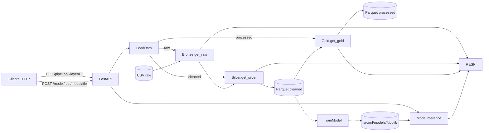

<div align="center">
  <h1>🥛 Análise Leite</h1>
  <h3>Milk Traceability &amp; Data Intelligence</h3>
  <p>
    <em>From farm collection to smarter, safer dairy decisions.</em>
  </p>

  <p>
    <a href="https://github.com/BrayanDevZN/AnaliseLeite/actions/workflows/build.yaml"></a>
  </p>

  <p>
    
    
    
    
    
  </p>
</div>

<p align="center">
  
</p>

## Sobre o projeto

O **Análise Leite** é um projeto de engenharia de dados voltado ao rastreamento da cadeia de coleta de uma cooperativa leiteira. Ele relaciona fazendas e coletas, trata os dados operacionais, calcula indicadores de qualidade, disponibiliza o resultado por uma API REST e inclui um modelo de machine learning que estima se o exame de uma coleta será aprovado ou reprovado.

O cenário parte de um problema real do setor: quando leite com resíduos ou fora dos padrões entra em um tanque comunitário, segue em um caminhão e chega a um silo, vários lotes podem ser afetados. Sem dados relacionados, é difícil reconstruir a origem do problema e distribuir responsabilidades de forma justa.

O pipeline ajuda a responder perguntas como:

- quais fazendas e silos apresentam os melhores indicadores de qualidade;
- qual é a média de aprovação dos exames;
- quais volumes, temperaturas, níveis de CCS e CPP foram registrados;
- quais tanques, motoristas e caminhões participaram da coleta;
- como os dados de cadastro das fazendas se relacionam aos eventos de coleta;
- quais características de uma coleta (temperatura, CCS, CPP, tanque, localização) estão associadas à reprovação do exame.

> Os dados presentes no repositório são fictícios e foram preparados para fins acadêmicos.

## Visão geral

| Componente | Responsabilidade |
|---|---|
| **FastAPI** | Expõe o pipeline em `GET /pipeline/` e o modelo em `POST /model/` e `POST /model/file` |
| **Pandas** | Lê, relaciona, limpa, agrupa e ordena os dados |
| **Parquet / PyArrow** | Armazena as camadas tratada e processada de forma eficiente |
| **scikit-learn / joblib** | Treina um `RandomForestClassifier` e persiste cada versão em `src/ml/models/` |
| **Docker Compose** | Sobe a API em container |
| **GitHub Actions** | Workflow `build`: sobe a API com Docker Compose e executa os testes |

Atualmente, a base contém:

- **40 fazendas** cadastradas;
- **1.092 coletas** na camada bruta;
- **120 registros agregados** por fazenda e silo na camada processada.

## Arquitetura

O ETL segue a arquitetura em camadas (medalhão): **bronze** (`raw`), **silver** (`cleaned`) e **gold** (`processed`). Cada classe herda da anterior, e `LoadData` escolhe qual camada entregar.



### Fluxo de uma requisição

1. O cliente chama `GET /pipeline/`, opcionalmente com `?layer=raw|cleaned|processed` (padrão: `processed`).
2. `LoadData(layer)` executa o método da camada pedida.
3. Cada camada reaproveita o arquivo já salvo quando ele existe e, se não existir, gera a partir da camada anterior.
4. O resultado é convertido em JSON: uma lista de registros, ou um objeto com as tabelas `fazendas` e `coletas` na camada `raw`.
5. A API responde com HTTP `201`.

### Fluxo de uma previsão

1. O cliente envia uma coleta em JSON (`POST /model/`) ou um arquivo `.parquet`/`.csv` com várias coletas (`POST /model/file`).
2. `ModelInference` carrega o modelo salvo em `src/ml/models/` (a API usa o `anl_v2`).
3. As colunas são preparadas do mesmo jeito que no treino: `data` vira ano, mês e dia, e `tanque`, `estado` e `cidade` viram colunas 0/1.
4. O modelo prevê `aprovado` ou `reprovado` para cada coleta.

## Pipeline ETL

### 1. Bronze — camada `raw`

O módulo `src/etl/bronze.py` (`Bronze.get_raw`) lê `fazendas.csv` e `coletas.csv`, ambos separados por `;`, e devolve as duas tabelas **sem alterações**, em um dicionário `{"fazendas": df, "coletas": df}`.

### 2. Silver — camada `cleaned`

O módulo `src/etl/silver.py` (`Silver.get_silver`):

- relaciona as tabelas por `fazenda_id` usando um *inner join*;
- converte `data` para data/hora;
- troca vírgula por ponto nos campos decimais;
- converte preço, temperatura, CCS e CPP para tipos numéricos;
- persiste o resultado em Parquet.

### 3. Gold — camada `processed`

O módulo `src/etl/gold.py` (`Gold.get_gold`):

- converte `resultado_exame` em `1` para aprovado e `0` para não aprovado;
- agrupa os dados por fazenda e silo;
- calcula médias de volume, temperatura, CCS, CPP e aprovação;
- aplica soma ao campo `preco_litro` dentro de cada agrupamento;
- preserva dados descritivos, como fazenda, produtor, tanque, motorista e caminhão;
- renomeia o indicador calculado para `media_aprovacao`;
- ordena os registros por CCS, CPP e média de aprovação;
- grava o resultado final em Parquet.

### 4. Interface — `LoadData`

O módulo `src/etl/interface.py` mapeia `raw`, `cleaned` e `processed` para `get_raw`, `get_silver` e `get_gold`. O formato devolvido depende **apenas da camada pedida**, e não do que já existe em disco. A leitura e a escrita dos arquivos ficam em `src/etl/file.py` (`DfFile`).

## Machine learning

O módulo `src/ml/train/` (`TrainModel`) treina um classificador que estima se o exame de uma coleta será **reprovado**, a partir de dados registrados na coleta.

| Item | Detalhe |
|---|---|
| **Algoritmo** | `RandomForestClassifier` (scikit-learn) |
| **Fonte dos dados** | Camada `cleaned`, com uma linha por coleta |
| **Alvo** | `resultado_exame`: `1` = reprovado, `0` = aprovado |
| **Features** | `temperatura`, `ccs`, `cpp`, ano, mês e dia (derivados de `data`) e `estado`, `cidade` e `tanque` (codificados em colunas 0/1) |
| **Saída** | Modelo serializado com `joblib` em `src/ml/models/<nome>.joblib` |

Parâmetros: 180 árvores, `max_depth=8`, `min_samples_leaf=9`, `max_features=0.6`, `criterion="gini"`, `class_weight="balanced"` (compensa o desbalanceamento entre aprovados e reprovados) e `random_state=42`.

Cada versão do modelo é salva com um nome escolhido por quem treina. O repositório traz `anl_v1`, `anl_v2` e `anl_alpine`, e a API usa o **`anl_v2`**.

Gerenciar os modelos, na raiz do projeto:

```bash
python -m src.ml.train.model train anl_v3   # treina e salva src/ml/models/anl_v3.joblib
python -m src.ml.train.model list           # lista os modelos disponíveis
python -m src.ml.train.model drop anl_v3    # apaga um modelo
```

## Camadas de dados

```text
src/storage/
├── raw/        # arquivos CSV recebidos
├── cleaned/    # dados relacionados, tipados e salvos em Parquet
├── processed/  # indicadores agregados, prontos para consumo
└── test/       # arquivo de exemplo usado nos testes do modelo
```

| Camada | Arquivo | Conteúdo |
|---|---|---|
| `raw` | `fazendas.csv` | Cadastro de fazendas, produtores, localização e preço por litro |
| `raw` | `coletas.csv` | Eventos de coleta, qualidade, logística, silo e resultado de exame |
| `cleaned` | `analise_leite.parquet` | Junção das fontes com tipos normalizados (uma linha por coleta) |
| `processed` | `analise_leite.parquet` | Agregação analítica por fazenda e silo |
| `test` | `analise_leite_teste.parquet` | Coletas de exemplo, no mesmo formato da `cleaned`, para testar o modelo |

Os principais indicadores de qualidade são:

- **CCS:** contagem de células somáticas; quanto menor, melhor;
- **CPP:** contagem padrão em placas, associada à carga bacteriana; quanto menor, melhor;
- **temperatura:** temperatura do leite no momento do registro;
- **média de aprovação:** proporção dos exames aprovados no agrupamento, de `0` a `1`.

## Estrutura do repositório

```text
AnaliseLeite/
├── assets/                    # imagens usadas na documentação
├── documents/                 # enunciado e contexto do problema
├── src/
│   ├── application/           # aplicação FastAPI
│   │   ├── handles/           # rotas: pipeline.py e model.py
│   │   └── schema.py          # modelo de entrada de POST /model/
│   ├── controller/            # Dockerfile, Compose e dependências
│   ├── etl/                   # camadas bronze, silver, gold e interface de carga
│   ├── logs/                  # configuração centralizada de logs
│   ├── ml/
│   │   ├── train/             # treino e gerenciamento de modelos (CLI)
│   │   ├── models/            # modelos salvos (.joblib)
│   │   └── inference.py       # carga do modelo e previsão
│   └── storage/               # camadas raw, cleaned, processed e test
├── tests/
│   ├── unit/                  # leitura da camada raw
│   ├── integration/           # integração entre as camadas do ETL
│   └── functional/            # chamadas HTTP à API e ao modelo
└── .github/workflows/         # workflow build (integração contínua)
```

## Como executar

### Opção recomendada: Docker Compose

Pré-requisitos:

- [Docker](https://docs.docker.com/get-docker/);
- Docker Compose v2.

Clone o projeto e entre na pasta:

```bash
git clone https://github.com/BrayanDevZN/AnaliseLeite.git
cd AnaliseLeite
```

Suba a API:

```bash
docker compose -f src/controller/compose.yml up --build
```

Quando os serviços estiverem prontos, acesse:

- API: <http://localhost:8000/pipeline/>
- Modelo: <http://localhost:8000/docs#/model> (rotas `POST /model/` e `POST /model/file`)
- Swagger UI: <http://localhost:8000/docs>
- OpenAPI: <http://localhost:8000/openapi.json>

Para encerrar os serviços:

```bash
docker compose -f src/controller/compose.yml down
```

### Execução local

Use Python 3.14.

```bash
python -m venv .venv
source .venv/bin/activate
python -m pip install --upgrade pip
pip install -r src/controller/requirements.txt
```

Depois, na raiz do projeto, inicie a API:

```bash
python -m uvicorn src.application.main:app --host 0.0.0.0 --port 8000 --reload
```

## Uso da API

### `GET /pipeline/`

Retorna os dados da camada escolhida em JSON.

| Parâmetro | Valores | Padrão |
|---|---|---|
| `layer` | `raw`, `cleaned`, `processed` | `processed` |

```bash
curl http://localhost:8000/pipeline/
curl "http://localhost:8000/pipeline/?layer=raw"
```

Na camada `raw` a resposta é um objeto com as duas tabelas: `{"fazendas": [...], "coletas": [...]}`.

Exemplo resumido de resposta (camada `processed`):

```json
[
  {
    "nome_fazenda": "Sitio Campo Verde II",
    "produtor": "Nelson Aguiar",
    "cidade": "Mateus Leme",
    "estado": "MG",
    "preco_litro": 19.62,
    "tanque": "TI15",
    "tipo_tanque": "individual",
    "volume_litros": 1227.78,
    "temperatura": 4.38,
    "ccs": 306.44,
    "cpp": 221.44,
    "motorista": "Djalma Souto",
    "caminhao": "CAM-102",
    "media_aprovacao": 0.89
  }
]
```

### `POST /model/file`

Recebe um arquivo `.parquet` ou `.csv` (separado por `;`) com várias coletas e devolve cada linha com a coluna `predict` (`aprovado` ou `reprovado`). O arquivo precisa ter as colunas `data`, `temperatura`, `ccs`, `cpp`, `tanque`, `estado` e `cidade`. As demais colunas são ignoradas na previsão.

```bash
curl -X POST "http://localhost:8000/model/file" \
  -F "file=@src/storage/test/analise_leite_teste.parquet"
```

O campo do formulário deve se chamar `file`. Qualquer outra extensão é recusada.

### `POST /model/`

Recebe uma coleta em JSON e devolve `"aprovado"` ou `"reprovado"`.

| Campo | Tipo | Exemplo |
|---|---|---|
| `temperature` | número | `4.2` |
| `state` | sigla do estado (UF) | `"MG"` |
| `data` | texto `AAAA-MM-DD` | `"2026-03-02"` |
| `ccs` | número | `480` |
| `cpp` | número | `250` |
| `cidade` | texto, sem acento | `"Betim"` |
| `tanque` | texto | `"TC01"` |

```bash
curl -X POST "http://localhost:8000/model/" \
  -H "Content-Type: application/json" \
  -d '{"temperature": 4.2, "state": "MG", "data": "2026-03-02", "ccs": 480, "cpp": 250, "cidade": "Betim", "tanque": "TC01"}'
```

## Testes e integração contínua

Os testes deste projeto são scripts executáveis como módulos Python.

```bash
# Unitários
python -m tests.unit.raw

# Integração
python -m tests.integration.silver
python -m tests.integration.gold

# Funcionais — requerem o pacote requests
pip install requests
python -m tests.functional.model   # avalia o modelo no arquivo de teste (roda sem a API)
python -m tests.functional.api     # chama a API em execução (GET /pipeline e POST /model/file)
```

O teste `functional.api` exige a API do Compose em execução.

No GitHub Actions há um único workflow, `build.yaml`, executado em *push* e *pull request* para `main` e `develop`. Ele sobe a API com Docker Compose, instala as dependências e roda, nesta ordem, o teste unitário, os de integração e os funcionais.

## Configuração

Porta padrão:

| Serviço | Porta |
|---|---:|
| API FastAPI | `8000` |

## Logs

A aplicação registra eventos no terminal com a biblioteca `watchguardian` (configurada em `src/logs/log.py`), incluindo leitura de camadas, transformações, carga de modelos e erros.

## Próximos passos

- avaliar o modelo com divisão treino/teste por fazenda e métricas de recall e precisão da classe `reprovado`;
- testar features de histórico por fazenda (médias e taxa de reprovação das coletas anteriores);
- adicionar filtros por fazenda, silo, período, motorista e resultado;
- preservar `fazenda_id` e `silo` como campos explícitos na resposta da camada `processed`;
- adotar modelos de resposta do Pydantic e documentação detalhada do contrato;
- transformar os scripts de teste em uma suíte com `pytest` e métricas de cobertura;
- incluir autenticação, paginação e observabilidade para um cenário de produção.

## Documentação do domínio

- [Cenário geral e orientações do trabalho](documents/leiame.md)
- [Problema de rastreamento do leite](documents/rastreamento.md)

---

<p align="center">
  Desenvolvido para transformar a cadeia do leite em uma operação mais rastreável, mensurável e transparente.
</p>
