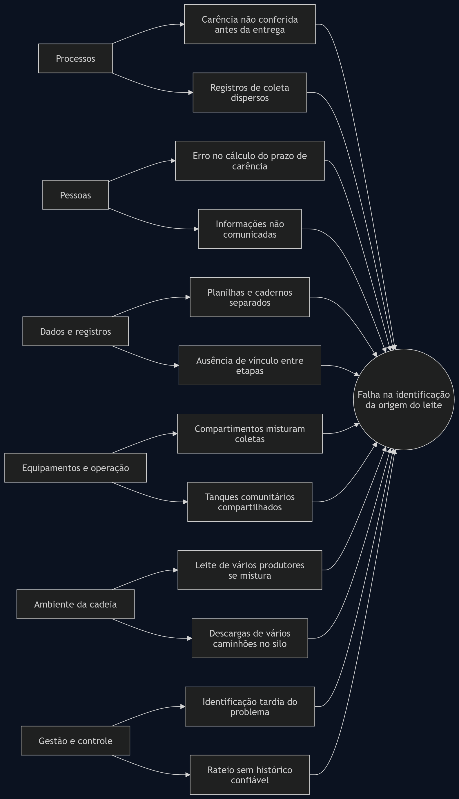
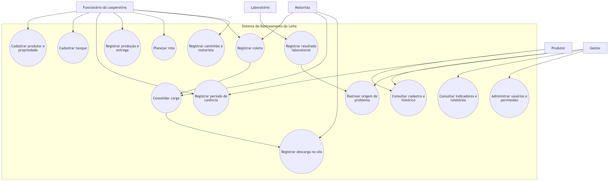
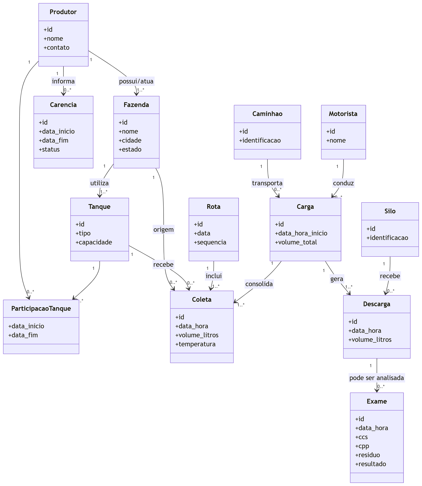

# Relatório do Projeto — Rastreamento do Leite

## Grupo 1 \| Projeto e Engenharia de Software — UC HUB

**Integrantes:**

Brayan Souza Dias Vaz / 62613574 / [souzabrayan534@gmail.com](mailto:souzabrayan534@gmail.com) / Ciências da Computação

Gustavo Alves Ramos / 62652645 / [gustavoalvesprofissionalti@gmail.com](mailto:gustavoalvesprofissionalti@gmail.com) / Ciências da Computação

Kammilly Vitória de Sousa / 62612524 / [kammillysousa67@gmail.com](mailto:kammillysousa67@gmail.com) / Ciências da Computação

Luiz Otávio Bartilheiro de Sousa / 62612506 / [bartilheiroluiz5@gmail.com](mailto:bartilheiroluiz5@gmail.com)

**Objetivo:** especificar e apresentar uma solução para rastrear o caminho do leite na cooperativa, desde a fazenda e o tanque até o caminhão e o silo, permitindo investigar problemas de qualidade e identificar os produtores e volumes potencialmente afetados.

---

# P — Plan (Planejar)

## 1\. Contexto e definição do problema

O problema central ocorre quando o leite de uma vaca em período de carência, após tratamento com antibiótico, é colocado no tanque e acaba sendo comercializado. O risco aumenta quando o tanque é comunitário, pois o leite de vários produtores se mistura. Em seguida, o caminhão recolhe leite de diferentes tanques em um mesmo compartimento e descarrega a carga em um silo que também pode receber leite de outros caminhões.

Quando o laboratório identifica um problema, como a presença de resíduos, a cooperativa pode não conseguir reconstruir a origem do leite e todas as misturas pelas quais ele passou. A descoberta pode ocorrer dias depois, inclusive após o fechamento do pagamento mensal. Sem registros integrados, o prejuízo pode ser dividido de maneira injusta ou atribuído a produtores que não tiveram responsabilidade.

Antes do projeto, a equipe entendia o caso principalmente como um erro individual do produtor. Durante o trabalho, percebeu que também é um problema de rastreabilidade e integração de dados: é necessário relacionar fazendas, produtores, tanques, coletas, rotas, caminhões, cargas, silos e resultados laboratoriais. A solução deve apoiar tanto a prevenção quanto a investigação posterior.

## 2\. Objetivos da solução

- Registrar as etapas da cadeia de coleta e transporte do leite.  
- Relacionar produtores, fazendas, tanques, coletas, caminhões, motoristas e silos.  
- Registrar períodos de carência e impedir que leite não comercializável seja liberado.  
- Acompanhar indicadores de qualidade, incluindo temperatura, CCS, CPP e resultado de exame.  
- Rastrear as movimentações relacionadas a uma coleta ou a um resultado reprovado.  
- Dar à gestão informações para avaliar volumes, qualidade e possíveis prejuízos.  
- Evoluir para alertas preventivos de risco por fazenda, apoiados por análise dos dados.

## 3\. Diagrama de Ishikawa

O diagrama organiza causas potenciais do problema em seis dimensões. As causas abaixo são hipóteses de análise coerentes com o cenário e com os requisitos levantados; devem ser confirmadas ou detalhadas nas conversas com o gestor.

## 4\. Análise SWOT

| Forças (internas) | Fraquezas (internas) |
| :---- | :---- |
| Requisitos funcionais e regras de negócio identificados. | A operação descrita ainda depende de cadernos, planilhas e mensagens dispersas. |
| Dados de fazendas e coletas disponíveis para prototipação e análise. | A base fornecida não registra diretamente o período de carência dos animais nem o identificador de cada animal tratado. |
| Proposta de integração dos registros e geração de indicadores. | Os dados de exemplo não preservam, por si só, todos os vínculos históricos de mistura entre produtores, tanques, cargas e descargas. |
| Equipe identificou a importância de agir preventivamente. | A solução precisa de validação com dados reais e com os usuários da cooperativa. |

&nbsp;

| Oportunidades (externas) | Ameaças (externas) |
| :---- | :---- |
| Reduzir perdas e evitar que produtores sem responsabilidade sejam prejudicados. | Resistência de produtores ou funcionários à adoção de novos registros e processos. |
| Apoiar outras cooperativas e laticínios com uma solução de rastreabilidade. | Dados incompletos ou lançados incorretamente podem comprometer os alertas. |
| Criar alertas de risco e melhorar a tomada de decisão. | A mistura física do leite torna a reconstrução de origem complexa se os eventos não forem registrados no momento em que ocorrem. |
| Evoluir para serviço ou software por assinatura, após validação. | Segurança, disponibilidade e confiabilidade serão necessárias para uso operacional. |

## 5\. Requisitos do sistema

Os requisitos funcionais a seguir foram organizados a partir do levantamento do Grupo 1\. A prioridade é garantir o registro de cada etapa e a capacidade de rastrear os vínculos.

| ID | Requisito funcional |
| :---- | :---- |
| RF01 | Permitir cadastrar e consultar produtores da cooperativa. |
| RF02 | Cadastrar propriedades e tanques, identificando quais produtores utilizam cada tanque. |
| RF03 | Registrar o volume de leite entregue por produtor e a data da produção/entrega. |
| RF04 | Registrar períodos de carência e sinalizar que o leite correspondente não pode ser comercializado. |
| RF05 | Registrar coletas com tanque, quantidade, data, horário e responsável. |
| RF06 | Registrar rotas e os tanques/propriedades visitados em cada rota. |
| RF07 | Manter cadastro de caminhões e motoristas responsáveis pelas coletas. |
| RF08 | Registrar quais coletas compõem cada carga transportada. |
| RF09 | Registrar a chegada do caminhão ao laticínio, o silo de destino e a quantidade descarregada. |
| RF10 | Registrar análises de qualidade, incluindo CCS, CPP e presença de resíduos. |
| RF11 | Permitir rastrear produtores, tanques, rotas e cargas relacionados a um problema de qualidade. |
| RF12 | Gerar relatórios e indicadores de produção, qualidade, perdas e possíveis prejuízos. |

### Requisitos não funcionais

| ID | Requisito não funcional |
| :---- | :---- |
| RNF01 | Facilidade de uso: a interface deve ser simples para os funcionários da cooperativa. |
| RNF02 | Segurança: cada usuário deve acessar somente as funções necessárias ao seu trabalho. |
| RNF03 | Confiabilidade: os registros devem ser armazenados corretamente e evitar perda ou inconsistência de informações. |
| RNF04 | Histórico/rastreabilidade: manter o histórico das movimentações para reconstruir o caminho do leite. |
| RNF05 | Backup: manter cópias de segurança dos registros. |

### Regras de negócio

1. Leite de animal em período de carência não pode ser comercializado.  
2. Um tanque comunitário pode receber leite de vários produtores.  
3. Uma rota pode passar por vários tanques.  
4. Leite de diferentes tanques pode ser misturado no caminhão.  
5. Diferentes cargas podem ser descarregadas em um mesmo silo.  
6. Diante de um problema de qualidade, o sistema deve identificar todos os produtores e movimentações potencialmente relacionados.  
7. CCS e CPP devem ser utilizados no acompanhamento da qualidade; valores menores representam melhor qualidade, conforme o material orientador.  
8. Coletas e descargas devem registrar data e horário.

### Limites e pontos a confirmar com o cliente

- Como a cooperativa registra atualmente o início e o fim da carência de cada animal?  
- O registro de carência será feito por animal, por produtor ou por propriedade? Quem terá permissão para informar e encerrar o período?  
- Como identificar o leite de cada produtor quando vários produtores usam o mesmo tanque comunitário?  
- O caminhão possui compartimentos independentes ou um único compartimento? O cenário orientador descreve um compartimento único.  
- Como registrar a sequência e o volume de cada coleta dentro de uma carga?  
- Como o laboratório associa cada resultado ao tanque, à carga ou ao silo analisado?  
- Qual regra será usada para calcular o rateio de perdas quando houver mistura em tanque, caminhão e silo?  
- Quais limites de CCS, CPP e temperatura serão adotados pela cooperativa? Os arquivos fornecidos não definem limites de aprovação.

---

# D — Do (Executar)

## 6\. Visão geral da solução proposta

A solução é um sistema de informação com cadastros, registro operacional e histórico de movimentações. Cada evento deve possuir identificador, data e horário, responsável e vínculos com os eventos anteriores e seguintes. Assim, uma consulta a um resultado de exame deve permitir percorrer o caminho inverso até as coletas, tanques e produtores relacionados.

O relatório final da equipe também descreve uma implementação técnica com ETL em camadas bronze, silver e gold, API REST, dashboard e um modelo de machine learning para indicar risco de reprovação por fazenda. Essa parte representa a evolução técnica relatada pela equipe. O sistema operacional completo de registro de carência e de rastreabilidade física de cada mistura ainda depende dos vínculos e funcionalidades detalhados neste documento.

## 7\. Diagrama de casos de uso

**Atores principais:** produtor, funcionário da cooperativa, motorista, laboratório e gestor. As permissões específicas de cada ator devem ser confirmadas com o cliente. O diagrama apresenta as principais interações esperadas, não uma definição final de telas ou tecnologia.

## 8\. Diagrama de classes conceitual

**Observação de modelagem:** `ParticipacaoTanque` representa o vínculo entre produtores e tanques comunitários, inclusive com período de participação. A associação entre `Carga` e `Coleta` é essencial para reconstruir quais coletas foram misturadas. A relação entre exame e descarga deve ser ajustada conforme o procedimento real de amostragem do laboratório. O modelo é conceitual e deve ser validado com o gestor.

---

# C — Check (Verificar)

## 9\. Dados utilizados

Foram analisados os arquivos CSV fornecidos para o Grupo 1:

- `fazendas.csv`: cadastro de 40 fazendas, com identificador, nome, produtor, cidade, estado e preço por litro.  
- `coletas.csv`: 1.092 registros de coleta, com data, fazenda, tanque, tipo de tanque, volume, temperatura, CCS, CPP, motorista, caminhão, silo e resultado do exame.

A relação entre as tabelas é feita pela coluna `fazenda_id`. Os arquivos abrangem o período de **01/09/2025 a 28/02/2026**, com 91 datas distintas. A base foi tratada como conjunto fictício de demonstração, conforme a orientação do projeto; portanto, os resultados abaixo descrevem somente os dados fornecidos e não devem ser interpretados como desempenho real de uma cooperativa.

### Resumo descritivo da base

| Informação | Resultado |
| :---- | ----: |
| Fazendas cadastradas | 40 |
| Registros de coleta | 1.092 |
| Tanques distintos identificados | 22 |
| Caminhões identificados | 3 |
| Motoristas identificados | 4 |
| Registros em tanques comunitários | 656 |
| Volume total registrado | 1.509.986 litros |
| Volume médio por registro de coleta | 1.382,77 litros |
| Temperatura média registrada | 4,31 °C |
| CCS média registrada | 512,59 |
| CPP média registrada | 248,34 |

### Resultado dos exames

| Resultado | Quantidade | Percentual |
| :---- | ----: | ----: |
| Aprovado | 1.058 | 96,89% |
| Reprovado | 34 | 3,11% |
| **Total** | **1.092** | **100%** |

O volume associado aos registros classificados como reprovados soma **49.919 litros**. Esse número é o volume dos registros com resultado reprovado na base; não representa automaticamente o prejuízo financeiro final, pois a base não detalha a regra de contaminação, o volume efetivamente descartado ou o rateio entre produtores.

### Distribuição por silo

| Silo | Registros de coleta | Volume registrado (L) | Registros reprovados |
| :---- | ----: | ----: | ----: |
| SILO-A | 364 | 501.342 | 13 |
| SILO-B | 364 | 499.943 | 11 |
| SILO-C | 364 | 508.701 | 10 |

## 10\. Indicadores propostos para o painel

O painel deve permitir filtros por período, fazenda, produtor, tanque, tipo de tanque, motorista, caminhão e silo, sempre que o campo estiver disponível na base.

| Nº | Indicador | Como apresentar / cálculo | O que ajuda a gestão a enxergar |
| ----: | :---- | :---- | :---- |
| 1 | Volume total coletado | Soma de `volume_litros` | Escala da operação no período. |
| 2 | Quantidade de coletas | Contagem de registros | Frequência das operações. |
| 3 | Percentual de exames reprovados | Reprovados ÷ total de exames × 100 | Proporção de registros com resultado reprovado. |
| 4 | Volume associado a reprovações | Soma do volume dos registros reprovados | Volume potencialmente envolvido em ocorrências. |
| 5 | Temperatura média | Média de `temperatura` | Comportamento da temperatura nas coletas. |
| 6 | CCS média | Média de `ccs` | Acompanhamento da contagem de células somáticas. |
| 7 | CPP média | Média de `cpp` | Acompanhamento da contagem de bactérias. |
| 8 | Volume por fazenda | Soma de litros agrupada por fazenda | Comparação da contribuição de cada fazenda. |
| 9 | Reprovações por silo | Contagem de exames reprovados agrupada por silo | Localização de concentração de ocorrências por silo. |
| 10 | Volume por tipo de tanque | Soma de litros por `tipo_tanque` | Comparação entre tanques comunitários e individuais. |
| 11 | Coletas por caminhão | Contagem de coletas agrupada por caminhão | Distribuição operacional por veículo. |
| 12 | Preço médio por litro cadastrado | Média de `preco_litro` na tabela de fazendas | Referência de preço cadastrado para análises futuras de impacto. |

**Atenção à interpretação:** os indicadores 1 a 11 podem ser calculados diretamente ou por agrupamento dos campos disponíveis. O indicador 12 é uma média simples dos preços cadastrados; para estimar valor financeiro de uma ocorrência, deve-se relacionar cada coleta à fazenda e multiplicar o volume pelo preço correspondente, além de confirmar a regra de perda com o cliente. Não há, nos CSVs, uma coluna específica que identifique resíduo de antibiótico: `resultado_exame` informa apenas aprovado/reprovado. Portanto, não se deve afirmar que toda reprovação foi causada por antibiótico.

## 11\. Relacionamento das tabelas no Power BI

O modelo de dados deve relacionar `fazendas[fazenda_id]` com `coletas[fazenda_id]`, em uma relação de **um para muitos**: uma fazenda pode possuir vários registros de coleta. Os campos cadastrais, como produtor, cidade e preço por litro, podem então ser usados para segmentar os indicadores da tabela de coletas.

Sugestão de organização visual do painel:

1. **Faixa superior:** cartões com volume total, número de coletas, percentual de reprovação e volume associado a reprovações.  
2. **Qualidade:** gráficos de temperatura média, CCS média e CPP média ao longo do período.  
3. **Rastreabilidade:** tabelas e gráficos por fazenda, tanque, caminhão e silo.  
4. **Detalhamento:** tabela de coletas com data, fazenda, tanque, volume, motorista, caminhão, silo e resultado do exame.

O relatório final da equipe descreve ainda um fluxo ETL em camadas bronze, silver e gold, uma API REST e um modelo de machine learning para estimar risco por fazenda. A equipe relata que ajustou as transformações e as versões do modelo e adicionou testes automatizados. Não foram apresentados, nos documentos consultados, métricas de avaliação do modelo (como precisão, recall ou matriz de confusão); por isso, este relatório não atribui desempenho preditivo ao modelo.

---

# A — Act (Agir e melhorar)

## 12\. Limitações identificadas

1. **Carência não aparece nos CSVs:** não há dados de animais tratados, medicamento, início ou fim do período de carência. Essa informação é central para prevenir a entrada de leite impróprio.  
2. **Vínculos de mistura incompletos:** a base de coletas identifica fazenda, tanque, caminhão e silo, mas não apresenta identificadores próprios de carga, descarga e sequência de eventos suficientes para reconstruir integralmente cada mistura.  
3. **Resultado laboratorial limitado:** o campo disponível informa aprovado/reprovado, sem detalhar o tipo de análise ou a causa da reprovação.  
4. **Limites de qualidade não especificados:** os documentos não definem faixas de aprovação para temperatura, CCS e CPP.  
5. **Prejuízo e rateio:** não há regra documentada para calcular a parcela de perda atribuível a cada produtor quando ocorre mistura.  
6. **Validação operacional pendente:** os fluxos e permissões precisam ser confirmados com o gestor, motoristas, funcionários e laboratório.  
7. **Modelo preditivo:** a proposta de machine learning precisa ser avaliada com dados reais e métricas adequadas antes de ser usada para decisões operacionais.

## 13\. Melhorias e próximos passos

- Levantar com o cliente o processo real de registro de tratamento e carência, definindo responsáveis, evidências e validações.  
- Criar identificadores para cada coleta, carga, descarga e amostra laboratorial, mantendo data, horário e responsável.  
- Registrar a composição de cada carga e de cada descarga, inclusive quando houver mistura de diferentes tanques e caminhões.  
- Definir com a cooperativa os limites de qualidade e as regras de bloqueio, alerta, descarte e rateio.  
- Implementar controle de acesso por perfil, autenticação, backup e histórico de alterações.  
- Testar o sistema com usuários reais e acompanhar erros de preenchimento e tempo necessário para registrar uma operação.  
- Validar o ETL e a API com dados reais, documentando as transformações e mantendo consistência entre treinamento e uso do modelo.  
- Avaliar o modelo de machine learning com separação temporal dos dados, métricas como precisão e recall e acompanhamento periódico de resultados.  
- Evoluir o painel com filtros por período e fazenda, detalhamento das ocorrências e alertas compreensíveis para o gestor.  
- Planejar uma implantação piloto em uma cooperativa antes de considerar a expansão para outras organizações.

## 14\. Considerações finais

O projeto evidencia que a dificuldade não está apenas em identificar um produtor depois de um exame reprovado, mas em registrar e relacionar corretamente os acontecimentos de toda a cadeia. A solução proposta organiza os dados e oferece uma base para acompanhar qualidade, volume e ocorrências. Para cumprir plenamente o objetivo de proteger produtores que não tiveram culpa e calcular perdas de forma justa, será indispensável registrar a carência e preservar o vínculo entre produtor, tanque, coleta, carga, descarga, silo e exame.

A equipe considera que a proposta tem potencial para continuar e receber investimento, desde que seja validada com dados reais e integrada à rotina da cooperativa. Uma evolução possível é oferecer a solução como serviço ou software por assinatura para cooperativas e laticínios. Antes disso, são necessários testes em campo, segurança, infraestrutura, treinamento dos usuários e validação do valor entregue ao gestor e aos produtores.

---

## Referências utilizadas

- **LEIA-ME (orientações gerais do projeto):** cenário da cooperativa, fases, entregável em PDCA, arquivos de dados e critérios de avaliação.  
- **Grupo 1 — Rastreamento do leite:** descrição específica da dor e checklist de entrega.  
- **Levantamento de Requisitos — Grupo 1:** requisitos funcionais e não funcionais, regras de negócio e objetivo do sistema.  
- **Relatório Final UC HUB:** entendimento do problema, objetivos, adaptações técnicas, desafios e visão futura da equipe.  
- **`coletas.csv` e `fazendas.csv`:** base fictícia utilizada para os cálculos descritivos apresentados na seção Check.

> **Nota:** os diagramas deste documento estão em Mermaid. Para visualizá-los, utilize um visualizador compatível com Mermaid, como o GitHub. Os indicadores foram calculados a partir dos CSVs entregues e podem ser reproduzidos no Power BI após relacionar as tabelas pela coluna `fazenda_id`.
